# Sumber Sira · Aplikasi Mobile & Web Admin

Tugas kelompok. Satu rancangan sistem dengan dua antarmuka, dari desain Figma **HI-FI** Sumber Sira. Frontend
(mobile dan web admin) sudah tersambung ke backend SumberSira untuk seluruh alur data.

| Bagian | Pengguna | Teknologi | Folder |
|---|---|---|---|
| **Mobile Application** | Pengunjung | **Flutter** (Dart) | `mobile/` |
| **Dashboard Web** | Admin / pengelola | **Next.js 16 (App Router) + TypeScript + Tailwind CSS 4** | `src/` |

Sumber Sira adalah wisata kolam mata air di Desa Putukrejo, Malang. Aplikasi ini untuk booking sewa alat
dan wahana, cek keramaian, perbagus foto dengan AI Photo Studio, tanya chatbot, dan ulasan. Panel admin dipakai pengelola.

## Menjalankan

Butuh Node.js 20 atau lebih baru.

```bash
npm install
npm run dev
```

Buka <http://localhost:3000>:

| Alamat | Isi |
|---|---|
| `/` | Halaman perkenalan web (introduction web) |
| `/admin` | Panel admin (wajib login, lihat akun demo di bawah). Desainnya untuk layar 1440 × 900 |

**Akun demo panel admin** (dibuat oleh `npm run seed` di backend; password disimpan sebagai hash):

| Peran | Email | Password | Hak akses |
|---|---|---|---|
| Pengelola (admin) | `admin@sumbersira.id` | `sumbersira` | Semua menu, termasuk mengubah harga dan mengelola akun petugas |
| Petugas Loket | `petugas@sumbersira.id` | `petugas123` | Dashboard, Booking, Tiket & Check-in, melihat Wahana & Harga, dan Akun |

Di halaman login ada tombol "Isi" untuk masing-masing akun. Penjelasan login dan hak akses ada di bagian
**Autentikasi & Otorisasi Admin** di bawah.

Perintah lain:

- `npm run build` untuk build produksi, `npm start` untuk menjalankan hasil build.
- `npm run lint` untuk ESLint.
- `npm run dev:turbo` untuk mode dev Turbopack. Lebih cepat, tetapi lihat catatan di bawah.

> **Kenapa `npm run dev` memakai webpack?** Kalau path folder proyek mengandung spasi
> (misalnya `D:\Tugas\Sumber Sira`), mode dev Turbopack kadang tidak memperbarui CSS Tailwind
> setelah file diubah. Kelas baru jadi tidak berpengaruh sampai server di-restart. Mode webpack
> tidak punya masalah ini. Kalau folder kamu tanpa spasi, `npm run dev:turbo` juga aman.

### Menjalankan bersama backend

Login admin, Wahana & Harga, tiket, Live Crowd, booking, pembayaran, ulasan, galeri, Insight, akun petugas, chat,
dan AI Photo diambil dari backend, yaitu repo
[SumberSira-backend](https://github.com/nibrasalghifary7/SumberSira-backend) (Express, Prisma, PostgreSQL di Neon).
Aplikasi mobile memakai backend yang sama.

```
Flutter (pengunjung) ──┐
                       ├──► SumberSira-backend (port 4000) ──► Neon PostgreSQL
Next.js (web admin) ───┘
```

1. **Jalankan backend lebih dulu.** Ikuti README backend: `npm install`, salin `.env.example` menjadi `.env` lalu isi
   `DATABASE_URL` (minta ke anggota tim, jangan di-commit), `npx prisma generate`, `npx prisma migrate deploy` (sekali, menambah
   tabel tiket dan chat; kalau menjawab `P1001`, pakai `npm run db:apply`), `npm run seed`, lalu `npm run dev`.
   Cek `http://localhost:4000/health`, hasilnya harus `{"ok":true}`.
2. **Jalankan web admin** dengan `npm run dev`. Alamat backend dibaca dari variabel `API_URL`, bawaannya `http://localhost:4000`.
   Kalau backend ada di alamat lain, buat file `.env.local` berisi `API_URL=...`. Kalau port 3000 sudah dipakai program lain,
   pakai `npx next dev --webpack -p 3001`.
3. **Jalankan aplikasi mobile.** Alamat backend lewat `--dart-define=API_URL=...`:
   - emulator Android: tidak perlu apa-apa (bawaan `http://10.0.2.2:4000`),
   - Flutter web di Chrome: `flutter run -d chrome --dart-define=API_URL=http://localhost:4000`,
   - HP fisik dengan Wi-Fi yang sama dengan laptop: `flutter run --dart-define=API_URL=http://IP-LAPTOP:4000`.

Daftar uji manual ujung ke ujung ada di [`docs/uji-manual.md`](docs/uji-manual.md).

Semua fitur butuh backend: login dan sesi admin, tiket, booking dan pembayaran, Live Crowd, ulasan, galeri,
Insight, harga, akun petugas, chat, dan AI Photo. Kalau backend belum jalan, halaman admin menampilkan pesan
"tidak bisa memuat" dan aplikasi mobile menampilkan galat dengan tombol coba lagi. Wahana, jam booking, dan harga
di mobile masih punya cadangan lokal supaya halaman itu tetap bisa dibuka.

**Supaya web admin cepat pindah halaman.** Database Neon ada di Ohio, jadi tiap query terasa lambat dari Indonesia.
Web admin menampilkan kerangka seketika lewat `loading.tsx`, dan data live di dashboard, tiket, serta booking
disegarkan berkala di browser. Untuk demo, paling cepat pakai `npm run build` lalu `npm start` (tanpa kompilasi
per halaman seperti mode dev), dan pindahkan database ke Neon region **Singapore**.

## Aplikasi Mobile (Flutter)

Butuh Flutter SDK 3.4x atau lebih baru.

```bash
cd mobile
flutter pub get
flutter run            # pilih perangkat: Android atau Chrome
flutter test           # uji format Rupiah, validasi form, label keramaian, jam booking, dan riwayat per WhatsApp
flutter build web      # hasil build ada di mobile/build/web
flutter build apk      # APK Android ada di mobile/build/app/outputs/flutter-apk/app-release.apk
```

Aplikasi pengunjung **tanpa login**. Login hanya ada di web admin. Sebagai gantinya, **riwayat tiket dan booking
diambil dari server per nomor WhatsApp**: nomor yang dipakai saat membeli menjadi kunci riwayat. Di Tiket & Booking pengunjung cukup
mengetik nomor WhatsApp lalu menekan Cari (nomor terakhir terisi otomatis), dan e-tiket atau invoice bisa dikirim ke WhatsApp.
Pertama kali dibuka alurnya Splash, Tentang, Onboarding, lalu Beranda. Berikutnya Splash langsung ke Beranda.

Tab bar kaca yang mengambang berisi 4 tab: **Beranda, Tiket & Booking, Galeri, Profil**. Tidak ada menu samping (garis tiga);
isinya dipindah menjadi tombol di Beranda, dan chatbot Tanya Sira mengambang di Beranda.

Riwayat akan muncul setelah kamu membeli tiket atau booking dengan nomor WhatsApp itu (database baru mulai kosong).

| Layar | File | Isi |
|---|---|---|
| Splash | `screens/splash_screen.dart` | Foto bergerak di atas, lembar gelap berisi logo dengan riak air, garis loading, lanjut otomatis 3,2 detik |
| Tentang | `screens/about_screen.dart` | Foto besar dengan panel kaca, carousel daya tarik, info jam buka, harga tiket, parkir, pembayaran |
| Onboarding | `screens/onboarding_screen.dart` | 3 halaman yang bisa digeser (PageView), pindah sendiri tiap 3 detik (titik aktif terisi sebagai penanda waktu, berhenti di halaman terakhir), tombol Kembali/Lanjut, Lewati |
| Beranda | `screens/home_tab.dart` | Header gelap dengan hero keramaian (angka persen besar), menu cepat AI Photo / Ulasan / Tentang, carousel foto (5 foto, teks berbeda), grafik batang jumlah pengunjung per jam |
| Chatbot Tanya Sira | `widgets/floating_chat.dart`, `data/chat_controller.dart` | Gelembung kaca mengambang di Beranda, bisa digeser; diketuk membesar jadi panel chat. Pertanyaan cepat dari `GET /chat/quick-questions`; pesan dikirim ke `POST /chat` dan dijawab FAQ pengelola. Pertanyaan yang tidak cocok dicatat backend agar dijawab admin |
| Tiket & Booking | `screens/tickets_tab.dart`, `widgets/booking_section.dart` | Tiga segmen: Tiket Masuk (beli tiket), Sewa & Wahana (jam dari `GET /booking-slots` dan daftar wahana dari `GET /rides`, dengan cadangan `assets/data/wahana.json` bila server mati, total dan Lanjut Booking mengambang), Riwayat (tiket dan invoice per nomor WhatsApp) |
| Beli Tiket Masuk | `screens/ticket_form_screen.dart` | Jumlah pengunjung, jam datang, parkir, nama, WhatsApp (divalidasi), bayar QRIS (sheet) atau tunai |
| E-Tiket (hasil input) | `screens/eticket_screen.dart` | QR tiket, status yang diperbarui dari server tiap beberapa detik, detail, kirim e-tiket ke WhatsApp |
| Ringkasan Booking | `screens/checkout_screen.dart` | Ringkasan booking, nama, WhatsApp, pembayaran QRIS |
| Bayar Booking QRIS | `screens/payment_screen.dart` | QR pembayaran dari backend, total, batas waktu 15 menit, cara bayar, tombol Saya Sudah Bayar (mode simulasi backend) |
| Booking Berhasil & Invoice | `screens/invoice_screen.dart` | QR kode booking, rincian yang sudah dibayar, kirim invoice ke WhatsApp |
| Galeri | `screens/gallery_tab.dart` | Foto dari `GET /gallery` (kiriman pengunjung yang disetujui admin): foto utama besar lalu grid 2 kolom, ketuk untuk melihat layar penuh dan zoom |
| Ulasan & Rating | `screens/reviews_screen.dart` | Rata-rata bintang dari server, tulis ulasan (pilih bintang + validasi), ulasan terbaru |
| AI Photo Studio | `screens/ai_photo_screen.dart`, `utils/photo_upload.dart` | Pilih foto dari galeri atau kamera, unggah ke `POST /ai-photo`, lalu tampilkan foto asli dan hasil perbaikan dari server berdampingan. Hasil bisa disimpan, dibagikan, atau dikirim ke Galeri Komunitas (menunggu persetujuan admin) |
| Profil | `screens/profile_tab.dart` | Nomor WhatsApp tersimpan, pengingat jam sepi, info wisata, Google Maps |

Alur booking: Tiket & Booking segmen Sewa & Wahana (pilih jam dan item), Lanjut Booking, Ringkasan Booking, Bayar Booking QRIS, Saya Sudah Bayar,
lalu Booking Berhasil & Invoice. Booking baru tersimpan setelah pembayaran.

Struktur `mobile/lib`: `screens/` (layar), `widgets/` (komponen yang dipakai ulang: kaca Liquid Glass, tab bar dan bar mengambang, kartu konten,
list inset grouped, header tab, logo bergerak, grafik per jam, chatbot mengambang, bagian booking, stepper), `models/` (Ticket, Booking, Review, Wahana, Galeri),
`data/` (`AppState`, `CrowdState`, `ChatController`, dan `ApiClient` berbasis ChangeNotifier/Future), `theme/` (warna dan font),
`utils/` (rute, format Rupiah dan nomor WhatsApp, validasi, unggah foto, pembuka tautan). Package: `google_fonts` (Fraunces, Inter), `cupertino_icons` (ikon gaya SF Symbols), `intl` (format Rupiah dan tanggal Indonesia), `qr_flutter` (kode QR),
`shared_preferences` (menyimpan nomor WhatsApp terakhir, tanda onboarding, dan pengaturan pengingat), `image_picker` + `http` (AI Photo), `share_plus` (bagikan hasil foto), dan `url_launcher` (membuka Google Maps dan WhatsApp).
Responsif: isi halaman bisa digulir, lebar maksimal 480 px di tengah untuk tablet/web, ukuran mengikuti layar lewat
`Expanded`, `Wrap`, `LayoutBuilder`, dan `SafeArea`, jadi tidak ada overflow saat layar kecil atau landscape.

### Materi kuliah mobile yang diterapkan

Di kode, bagian yang memakai materi kuliah diberi komentar penanda, misalnya `// [P4 Checkbox] ...`.

| Pertemuan | Materi | Dipakai di |
|---|---|---|
| P2 | `var`, `final`, `const`, class dan object, null safety (`?`, `??`) | `models/ticket.dart`, `data/dummy_data.dart`, `data/app_state.dart` |
| P3 | StatelessWidget, StatefulWidget, setState, Row, Column, Container, Padding, SizedBox, Stack, Positioned, Expanded, GridView | Semua layar, misalnya `home_tab.dart` (Stack untuk chatbot mengambang), `gallery_tab.dart` (GridView), `widgets/common.dart` |
| P4 | ElevatedButton, TextField + InputDecoration, TextEditingController, DropdownButton, Slider, Switch, Checkbox, RadioButton, Image.asset, Image.network | `ticket_form_screen.dart` (Dropdown, Radio, Checkbox), `home_tab.dart` dan `gallery_tab.dart` (Image.asset), `ai_photo_screen.dart` (Image.network), `profile_tab.dart` (Switch) |
| P5 | Navigator.push / pop, kirim data ke halaman lain, named route, navigasi tab | `main.dart` (routes + onGenerateRoute), `widgets/booking_section.dart` (kirim isi booking ke Checkout), `checkout_screen.dart` (kirim pesanan ke Bayar QRIS), `main_shell.dart` (tab bawah) |
| P6 | Package dan plugin (google_fonts, intl, shared_preferences, url_launcher, qr_flutter), Form + TextFormField + validator | `utils/format.dart` (intl), `data/app_state.dart` (shared_preferences: nomor WhatsApp terakhir, onboarding, pengingat jam sepi), `utils/launcher.dart` (url_launcher: Maps dan WhatsApp), `payment_screen.dart` (qr_flutter), `ticket_form_screen.dart`, `checkout_screen.dart`, `tickets_tab.dart` (Form) |

## Fitur AI

Hanya ada **dua** fitur AI. Grafik keramaian dan Insight di admin **bukan AI**: dihitung dari tiket yang discan petugas.

**1. Chatbot Tanya Sira (aplikasi pengunjung).** Pertanyaan cepat diambil dari `GET /chat/quick-questions`. Setiap
pesan dikirim ke `POST /chat`; backend mencocokkannya dengan FAQ buatan pengelola (tanpa LLM). Pertanyaan yang tidak
cocok disimpan backend dan muncul di halaman Chatbot & FAQ untuk dijawab admin. Menjawab pertanyaan berarti membuat
FAQ baru lalu menghapus pertanyaan itu, supaya pertanyaan serupa berikutnya dijawab otomatis.

**2. AI Photo Studio (aplikasi pengunjung).** Foto dari galeri atau kamera diunggah ke `POST /ai-photo`. Backend
memperbaiki warna dan ketajamannya (analisis sebaran warna, kecerahan, kontras, kepekatan warna), lalu mengembalikan
foto hasil. Aplikasi menampilkan foto asli dan hasil berdampingan; hasil bisa disimpan, dibagikan, atau dikirim ke
Galeri Komunitas untuk disetujui admin.

## Pemenuhan Soal UTS

| Ketentuan | Dashboard Web (Next.js + TypeScript) | Mobile Application (Flutter) |
|---|---|---|
| Halaman login (simulasi) | `/admin/login` | Tidak memakai login. Riwayat tiket dan booking dicari lewat nomor WhatsApp |
| Dashboard / halaman utama | `/admin` | `home_tab.dart` |
| Data berbentuk tabel atau kartu | Tabel booking, tiket, wahana, akun; kartu ringkasan | Kartu tiket, invoice, daftar wahana, galeri, ulasan |
| Pengelolaan data / form input | `/admin/wahana` (tambah, edit, hapus), `/admin/faq`, `/admin/staff`, `/admin/tiket` | `ticket_form_screen.dart`, `checkout_screen.dart`, `reviews_screen.dart` |
| Halaman hasil input | Tabel ikut berubah setelah aksi | `eticket_screen.dart`, `invoice_screen.dart`, `tickets_tab.dart` |
| Navigasi dan validasi | Sidebar, redirect login, validasi form | Named routes, tab bawah, validasi nama dan WhatsApp |
| Data | Dari backend (tiket, booking, pembayaran, keramaian, chat, ulasan, galeri, wahana, harga, akun) | Dari backend (semua fitur; cadangan lokal hanya untuk wahana, jam, dan harga) |
| AI | Chatbot (FAQ) dan AI Insight berbasis aturan | Chatbot Tanya Sira dan AI Photo Studio (lihat bagian Fitur AI) |

## Screenshot

| Login admin | Dashboard admin | Tiket & Check-in |
|---|---|---|
| 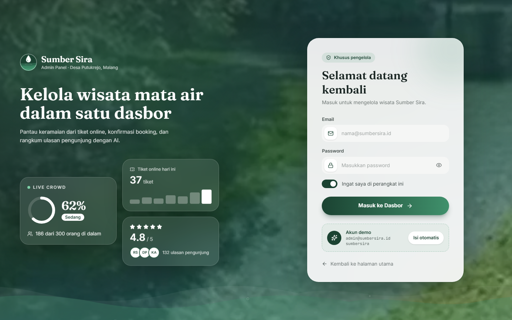 | 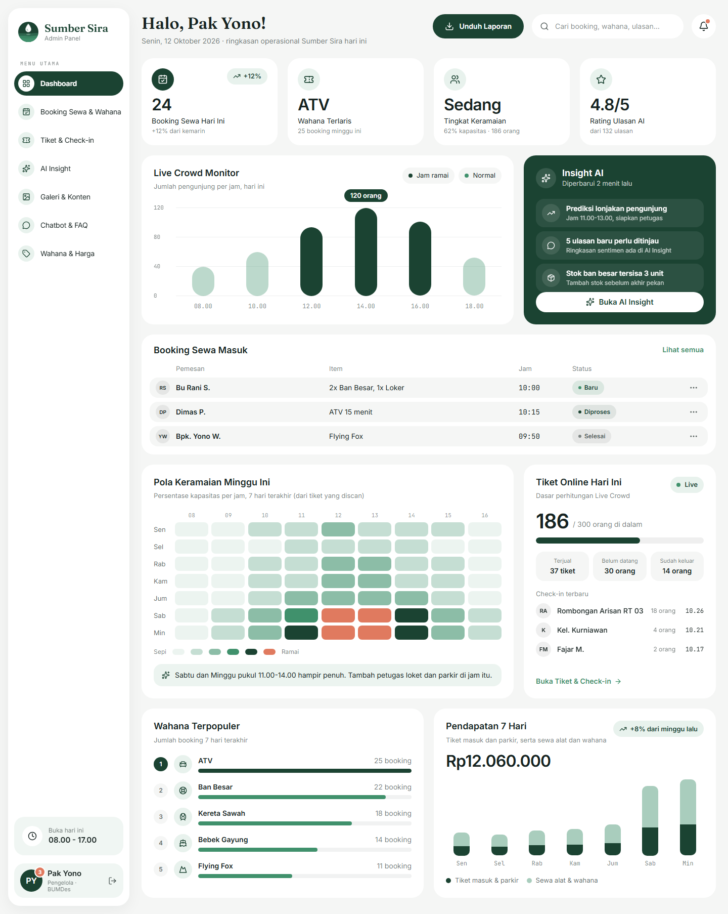 | 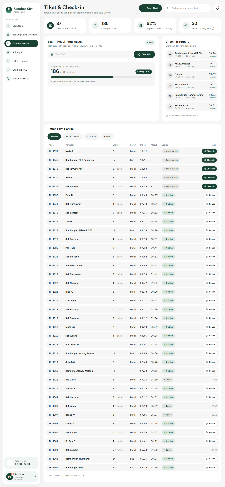 |

Aplikasi pengunjung (Flutter):

| Tentang | Onboarding | Beranda |
|---|---|---|
| 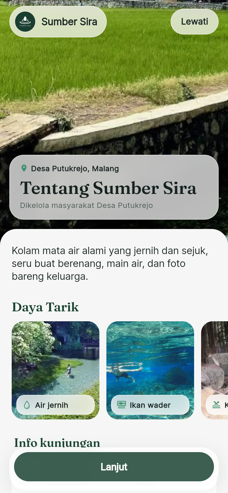 | 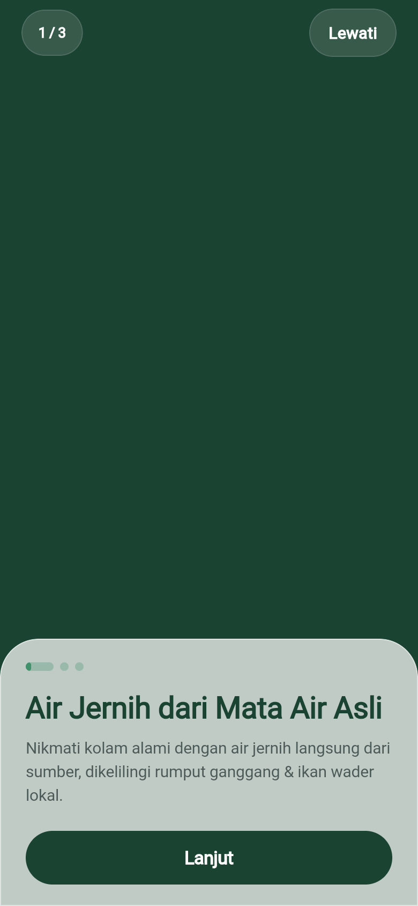 | 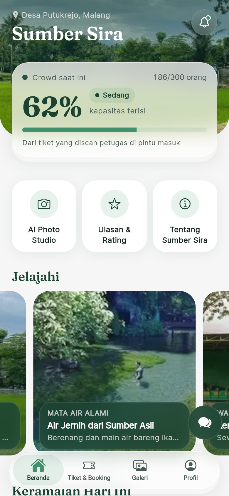 |

| Tanya Sira (mengambang di Beranda) | Tiket & Booking · Riwayat | Tiket & Booking · Sewa & Wahana |
|---|---|---|
| 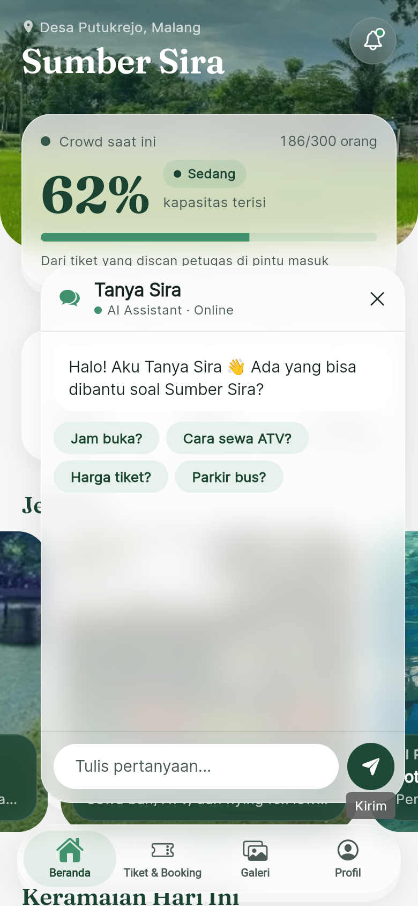 | 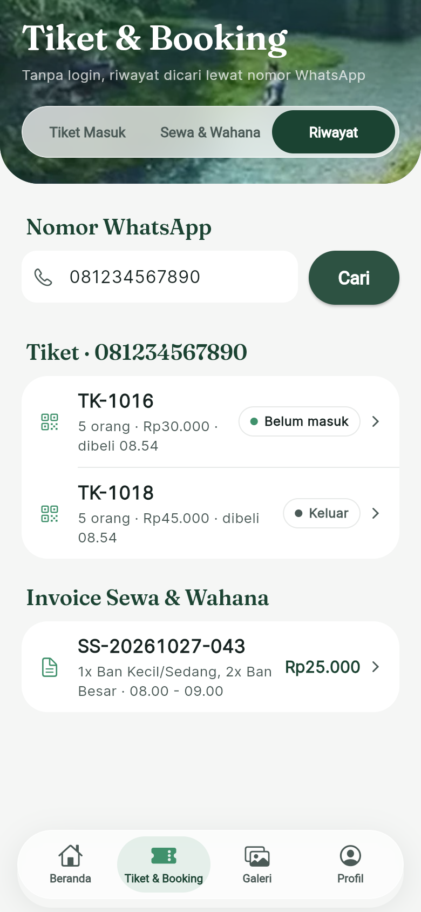 | 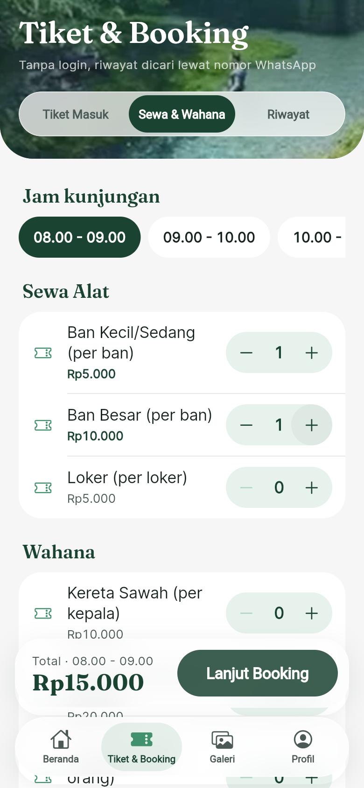 |

| Beli Tiket Masuk | E-Tiket | Ringkasan Booking |
|---|---|---|
| 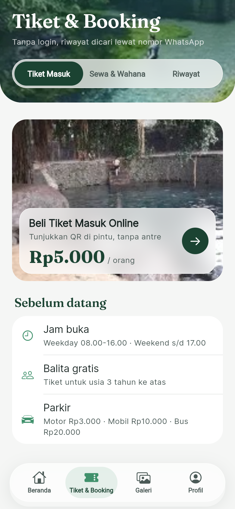 | 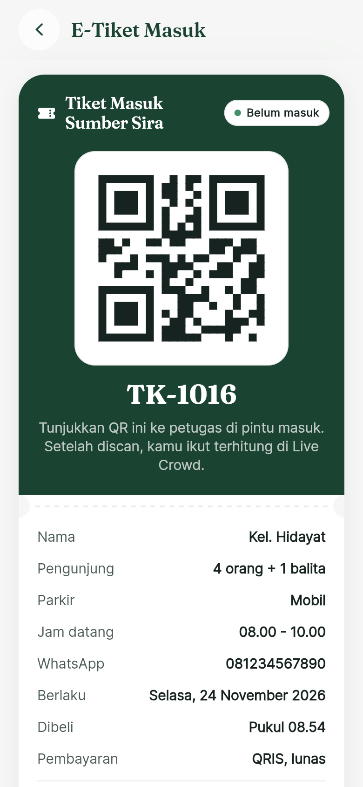 | 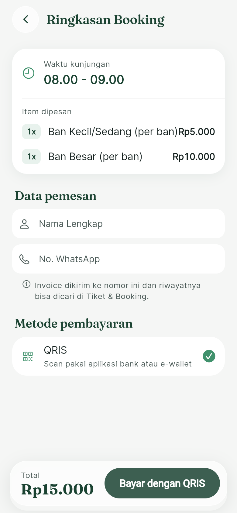 |

| Bayar Booking QRIS | Booking Berhasil & Invoice | Galeri |
|---|---|---|
| 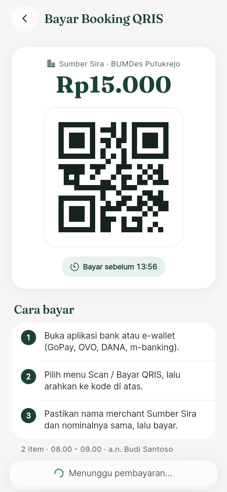 | 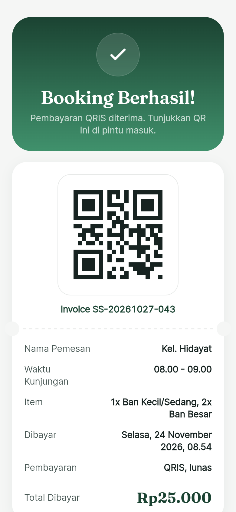 | 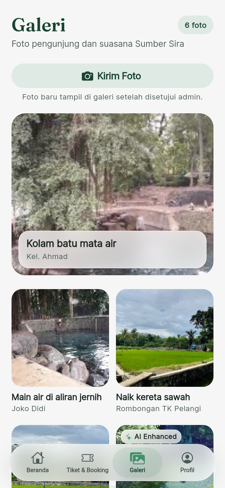 |

| Ulasan & Rating | Profil | AI Photo Studio |
|---|---|---|
| 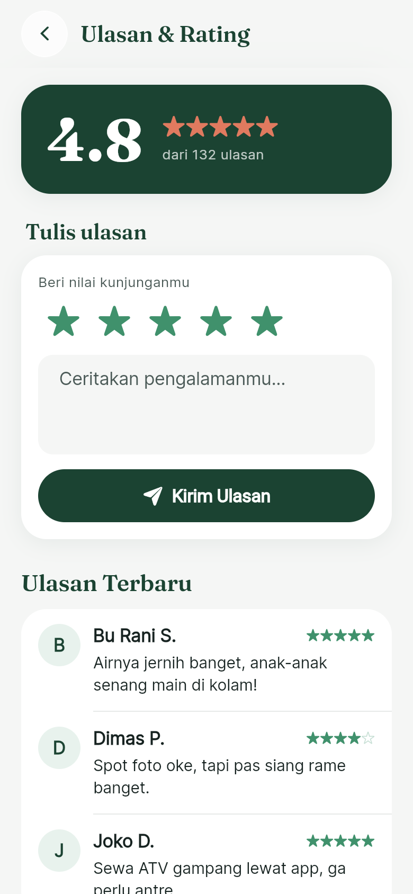 | 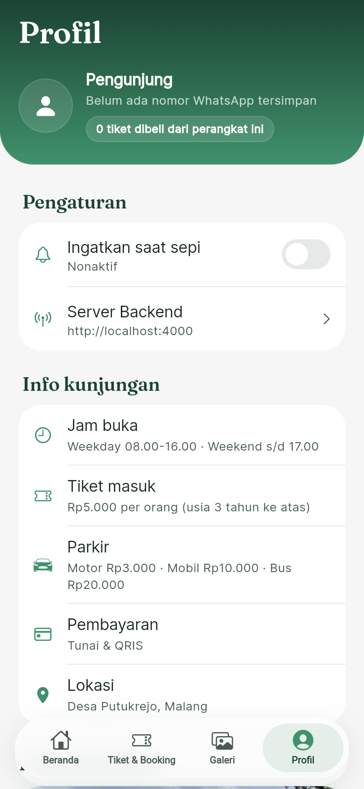 | 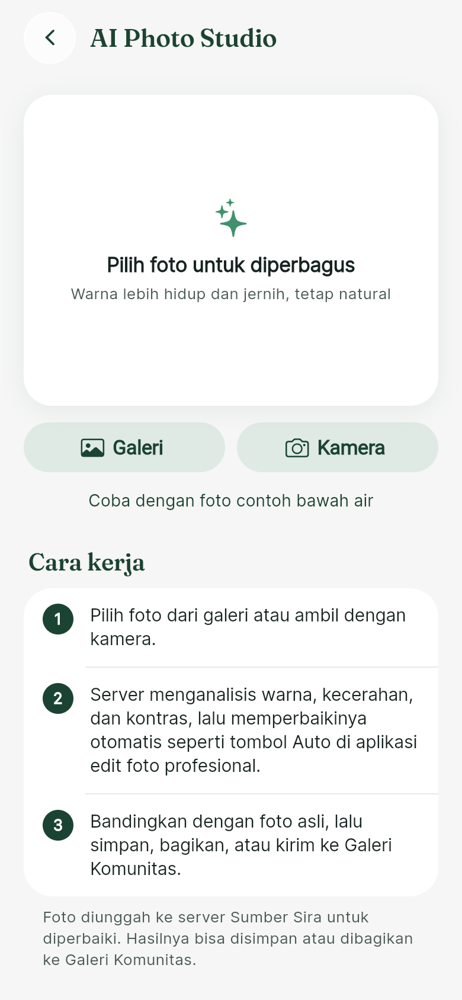 |

Ekspor desain Figma lengkap ada di folder `desain/`.

## Halaman

### Panel admin

| Rute | Halaman |
|---|---|
| `/admin/login` | Masuk admin. Semua halaman `/admin` lain wajib login, tombol keluar ada di kartu profil sidebar |
| `/admin/akun` | Akun & Sesi: profil, hak akses, daftar sesi login aktif milik akun ini, cabut sesi perangkat lain, ganti password sendiri |
| `/admin` | Dashboard Overview (kartu ringkasan, grafik batang pill beranimasi, ringkasan hari ini, booking masuk, heatmap keramaian seminggu, tiket online hari ini, wahana terpopuler, pendapatan 7 hari). Angka keramaian dan tiket dari tiket yang discan |
| `/admin/booking` | Booking Sewa & Wahana (filter, cari lewat kotak cari di header, detail booking, konfirmasi/tolak) |
| `/admin/tiket` | Tiket & Check-in: scan kode tiket di pintu masuk, daftar tiket hari ini, check-in dan keluar |
| `/admin/insight` | AI Insight: rating dan sebaran ulasan, keramaian saat ini, jam terpadat, dan saran dari `GET /admin/insight`. Bagian lama yang datanya tidak disediakan backend (grafik per 30 menit, rincian tiket, pola 7 hari, pilih tanggal, unduh CSV) disembunyikan. Analisisnya aturan, bukan LLM |
| `/admin/galeri` | Galeri & Konten (moderasi foto kiriman pengunjung dari backend, urut terbaru/terlama, tampilan grid atau daftar) |
| `/admin/faq` | Chatbot & FAQ: kelola FAQ jawaban cepat, lihat pertanyaan pengunjung yang belum terjawab. Menjawab = membuat FAQ baru lalu menghapus pertanyaan itu |
| `/admin/wahana` | Wahana & Harga (filter kategori, tambah, edit, hapus) dan harga tiket masuk, kapasitas, serta tarif parkir. Petugas hanya melihat; admin bisa mengubah |
| `/admin/staff` | Akun Petugas (khusus admin): tambah akun, ubah nama/peran/status, atur ulang password. Menonaktifkan akun atau mengatur ulang password mencabut semua sesinya |

Tampilan admin mengikuti desain admin terbaru di Figma: sidebar berupa kartu putih yang melayang, menu aktif
berbentuk pill Hijau Tua, kartu statistik membulat dengan ikon di dalam lingkaran, grafik batang berbentuk pill,
baris tabel membulat, dan status berbentuk pill. Warnanya tetap dua hijau yang sama.

### Tiket online dan Live Crowd

Angka Live Crowd dihitung dari tiket masuk online: jumlah orang dari tiket yang sudah **discan petugas** di pintu masuk dan
belum keluar, dibagi kapasitas 300 orang (di bawah 40% Sepi, sampai 75% Sedang, di atasnya Ramai). Hanya tiket yang berlaku
hari itu (WIB) yang dihitung. Check-in menaikkan grafik, check-out atau keluar menurunkannya.

Alurnya: pengunjung membeli tiket di aplikasi (`POST /tickets`, harga dihitung server) lalu tiketnya muncul di `/admin/tiket`.
Petugas menekan Check-in (atau mengetik kode, mis. `1036`), dan angka di web admin, widget di halaman login, dan Beranda
aplikasi ikut naik. E-tiket di aplikasi memeriksa statusnya tiap 6 detik, jadi langsung berubah jadi "Di dalam" begitu discan.
Data web admin ada di `src/lib/tiket-store.ts` (mengambil dari backend tiap 5 detik, dan tombol Check-in langsung mengubah tampilan
sebelum jawaban server datang). Untuk mencoba grafik tanpa menunggu pengunjung sungguhan: `npm run seed:demo` di backend.

## Autentikasi & Otorisasi Admin (Pertemuan 9)

Login hanya ada di panel admin. Aplikasi pengunjung (Flutter) tidak memakai login.
Autentikasi = membuktikan siapa yang masuk (email + password). Otorisasi = menentukan apa yang boleh dilakukan
akun itu (peran admin atau petugas).

| Materi | Penerapan | Letak |
|---|---|---|
| Hash password | Password disimpan di database backend sebagai hash scrypt + salt, dibandingkan dengan `timingSafeEqual` | repo backend: `src/lib/password.ts` |
| Session berbasis server | Backend menyimpan sesi di database, browser hanya memegang ID acak (yang disimpan adalah hash-nya). ID baru setiap login, sesi bisa dicabut seketika | repo backend: `src/routes/auth.ts`, `src/middleware/auth.ts` |
| Cookie aman | `HttpOnly`, `Secure`, `SameSite=Lax`. "Ingat saya" = 7 hari, tanpa itu cookie hilang saat browser ditutup (maks 8 jam). Token dari backend disimpan ke cookie oleh Next.js | `loginAction()` di `actions.ts` |
| Login lewat Server Action | Validasi isian, batas 5 kali salah lalu dikunci 1 menit, password dicek backend, pesan error sama untuk email/password salah | `src/lib/auth/login.ts`, `actions.ts`, `src/app/admin/login/` |
| Login lewat API (token) | `POST /api/auth/login` dengan body JSON email + password diteruskan ke backend dan mengembalikan token `Bearer` (token sesi dari backend). Token dipakai di header `Authorization: Bearer <token>` (mis. `GET /api/admin/me`), `POST /api/auth/logout` mencabutnya di backend. Validasi dan batas percobaan sama dengan form | `src/app/api/auth/`, `src/lib/auth/login.ts` |
| Validasi email | Wajib satu tanda @ dan ada titik setelah @, hanya huruf, angka, titik, garis bawah, dan tanda hubung. Karakter seperti `( : & " '` dan spasi ditolak. Dicek di browser (pesan di bawah kolom email, form tidak dikirim) dan dicek ulang di server (form maupun API, API membalas `400`) | `src/lib/validation/email.ts`, `LoginForm.tsx`, `login.ts` |
| proxy.ts | Cek kasar: tanpa cookie sesi diarahkan ke `/admin/login?next=...`. Cookie ada belum tentu valid | `src/proxy.ts` |
| DAL (Data Access Layer) | Satu pintu cek sesi dan peran: `server-only`, `cache()`, data admin dikirim tanpa hash password | `src/lib/auth/dal.ts` |
| Layout / page | Layout `(panel)` hanya mengambil data untuk sidebar; setiap `page.tsx` cek izin sendiri lewat DAL | `src/app/admin/(panel)/` |
| RBAC | Peran `admin` dan `petugas` dengan daftar izin. Menu sidebar disaring sesuai peran (hanya tampilan) | `src/lib/auth/roles.ts`, `Sidebar.tsx` |
| 401 vs 403 | Belum login: dialihkan ke login, API membalas 401. Sudah login tapi tidak berizin: halaman 403 (`forbidden()`) | `dal.ts`, `(panel)/forbidden.tsx`, `src/app/api/admin/me/route.ts` |
| Server Action khusus admin | Tambah/edit/hapus wahana, simpan harga, kelola akun petugas, dan ganti password: autentikasi, otorisasi, validasi, ubah data, revalidasi. Ditolak = `FORBIDDEN` bertipe | `wahana/actions.ts`, `staff/actions.ts`, `lib/auth/actions.ts` |
| Query terbatas (cegah IDOR) | Daftar dan pencabutan sesi hanya untuk sesi milik akun yang login; sesi akun lain dianggap tidak ada | repo backend: `/auth/sessions` di `src/routes/auth.ts` |
| Open redirect | `?next=` hanya boleh halaman di dalam `/admin` | `src/lib/auth/redirect.ts` |

Cara mencoba:

1. Buka `/admin/wahana` tanpa login: diarahkan ke login, setelah masuk kembali ke Wahana.
2. Masuk sebagai Petugas: sidebar hanya 5 menu. Buka `/admin/insight` atau `/admin/staff` lewat alamat langsung: halaman 403.
3. Masih sebagai Petugas, tekan hapus atau edit di Wahana & Harga: server menolak dengan `403 FORBIDDEN`.
4. Masuk sebagai Admin: semua menu terbuka dan harga bisa diubah.
5. DevTools, tab Application, lalu Cookies: cookie `ss_admin_session` bertanda HttpOnly, Secure, SameSite Lax.
6. Buka `/api/admin/me` tanpa login: `401`. Halaman Akun & Sesi: cabut sesi perangkat lain, perangkat itu langsung keluar.
7. Di form login, ketik email seperti `admin@sumbersira` atau `ad(min)@sumbersira.id`: pesan muncul di bawah kolom email dan form tidak dikirim.
8. Postman: jalankan backend dan web admin (lihat Menjalankan bersama backend), isi variabel `baseUrl` dengan alamat web (mis. `http://localhost:3001`),
   lalu jalankan request berikut berurutan (koleksi Postman disimpan lokal di folder `postman/`, folder itu tidak ikut di-commit):
   login dapat token (`200`), data admin pakai token (`200`), tanpa token (`401`), akun salah (`401`), empat email salah format (`400`),
   logout (`200`), lalu token lama ditolak (`401`). Token hasil login otomatis disimpan ke variabel `{{token}}`.

Catatan tahap ini: akun, sesi, dan data wahana disimpan di database backend (Neon), jadi tidak hilang saat web dimatikan.
Backend membatasi 5 kegagalan login per menit per email, dan form Next.js menambah batas 5 kali salah dalam 10 menit.
Login Google (OAuth) dan MFA belum dibuat karena butuh akun penyedia (Google Cloud).

## Syarat dosen dan letaknya

| Syarat | Implementasi |
|---|---|
| Gunakan Next.js | Next.js 16 App Router + TypeScript (`src/app`) |
| UTS fokus frontend web, minimal 3 slide (admin) | 6 halaman admin di `src/app/admin` |
| Animasi grafik di admin | `src/components/charts/`: batang pill tumbuh dari bawah (`BarChart`), garis keramaian digambar kiri ke kanan (`AreaChart`), donat rincian pembayaran muncul (`DonutChart`), batang parkir mengisi (`ProgressBar`) |
| Introduction web | `src/app/(intro)/page.tsx` |
| Tiap section halaman jadi file sendiri (Pertemuan 10) | Folder `components/` di dalam folder tiap halaman, `page.tsx` hanya menyusun section |

## Struktur folder

```
mobile/                Aplikasi pengunjung (Flutter), lihat bagian Aplikasi Mobile
desain/                PNG ekspor dari Figma (acuan tampilan: mobile 2×, admin 1,25×)
  foto/                Foto asli Sumber Sira yang dipakai aplikasi (di-import lewat src/lib/foto.ts)
src/app/               Halaman (App Router). Tiap halaman punya folder components/ berisi section-nya,
                       page.tsx hanya menyusun section. Folder (nama) = route group, tidak mengubah alamat
  (intro)/             Intro web, alamat /
    page.tsx
    components/        Hero, Fitur, InfoKunjungan, Footer
  mobile/page.tsx      Halaman info aplikasi pengunjung (cara menjalankan Flutter dan contoh layar), alamat /mobile
  admin/login/         Halaman login admin, alamat /admin/login
    page.tsx           Server: cek sesi lalu susun section
    components/        LoginBackdrop, LoginIntro, LoginWidgets, BrandMobile, LoginForm, WidgetTablet
  admin/(panel)/       Halaman admin yang wajib login: layout sidebar, forbidden.tsx (403), tiap page.tsx cek izin lewat DAL
    (dashboard)/       Dashboard, alamat /admin
      page.tsx
      components/      StatRingkasan, LiveCrowdMonitor, RingkasanHariIni, BookingMasuk, TiketHariIni,
                       WahanaPopuler, PendapatanMingguan, LiveCrowdStat, TiketTerjualStat, Today
    booking/components/  BookingView (data + pilihan), StatBooking, DaftarBooking, DetailBooking
    tiket/components/    TiketView, StatTiket, ScanTiket, CheckinTerbaru, DaftarTiket
    insight/components/  InsightView, StatInsight, SebaranRating, SaranInsight
    galeri/components/   GaleriView, StatGaleri, ToolbarGaleri, FotoGrid, FotoList, AiBadge, AksiFoto
    faq/components/      FaqView, StatFaq, AlurJawaban, DaftarFaq, BelumTerjawab, FormFaq
    wahana/components/   WahanaView, PesanAkses, StatWahana, DaftarWahana, FormWahana, PricingCard
                         (Server Action di wahana/actions.ts)
    staff/components/    StaffView, FormStaff (Server Action di staff/actions.ts, khusus admin)
    akun/components/     Profil, SesiLogin, SesiList, GantiPassword
  api/admin/me/        Route Handler contoh yang dilindungi (401 bila belum login atau token tidak berlaku)
  api/admin/[...path]/ Penerus ke backend untuk dashboard, tiket, booking, dan pembayaran (sesi login ikut diteruskan)
  api/crowd/           Live Crowd publik untuk widget halaman login
  admin/(panel)/loading.tsx  Kerangka yang tampil seketika saat pindah halaman
  api/auth/            login (token Bearer untuk Postman) dan logout lewat API
src/proxy.ts           Cek kasar cookie sesi sebelum masuk /admin (dulu middleware.ts)
src/components/        Komponen yang dipakai banyak halaman
  charts/              BarChart, AreaChart, DonutChart, Heatmap (admin), ProgressBar (beranimasi)
  admin/               AdminShell, Sidebar (menu sesuai peran), ui.tsx (AdminHeader, Card, StatCard, ...)
  Logo.tsx              Logo Sumber Sira (lingkaran hijau tua: tetes air, percikan, riak, tulisan SUMBER SIRA), juga di src/app/icon.svg
  WahanaIcon.tsx        Ikon per wahana
src/data/              Katalog wahana bawaan (wahana.ts)
src/lib/
  tiket-store.ts       Tiket masuk online + angka Live Crowd (dari backend, diperbarui berkala)
  booking-store.ts     Daftar booking admin (halaman per halaman) dan aksi pembayaran
  dashboard-store.ts   Ringkasan dashboard (dari backend, diperbarui berkala)
  crowd-store.ts       Live Crowd publik untuk halaman login
  mingguan-store.ts    Agregasi 7 hari (heatmap, wahana populer, pendapatan) dari data backend
  live/                Penyimpan data berkala (poll-store) dan pemanggil API (http)
  auth/                Autentikasi & otorisasi admin: dal.ts (Data Access Layer), roles.ts (peran dan izin),
                       actions.ts (login, logout, cabut sesi, ganti password), login.ts (alur login yang sama
                       untuk form dan API), constants.ts, redirect.ts, device.ts
  validation/email.ts  Aturan email yang dipakai form di browser dan pengecekan di server
  server/api.ts        Pemanggil backend dari server Next.js (meneruskan sesi dan User-Agent)
  server/wahana-store.ts  Data wahana di server untuk Server Action khusus admin
  nice-ticks.ts        Skala sumbu grafik batang keramaian
  whatsapp.ts          Pesan invoice WhatsApp
  format.ts            Format Rupiah dan kode booking
  foto.ts              Import semua foto aplikasi dari desain/foto
```

## Catatan desain

- Ukuran mengikuti Figma: frame mobile **375 × 812** dan admin **1440 × 900**. PNG mobile di `desain/`
  diekspor 2× (1 px di kode = 2 px di PNG), PNG admin diekspor 1,25× (1 px di kode = 1,25 px di PNG).
  Ukuran teks, jarak, dan kartu diukur dari PNG.
- Tampilan mobile mengikuti gaya iOS 27 (Liquid Glass), hanya mode terang, dengan dua lapisan yang jelas:
  lapisan navigasi (tab bar, nav bar saat digulir, CTA mengambang, sheet) dari kaca, lapisan konten (kartu, list, foto, form) permukaan putih solid.
  Kaca terang = Putih 72% + blur + garis tepi Putih 50% + bayangan 0 8 24 Ink 10%; kaca gelap = Putih 12% + blur; CTA primer = Hijau Tua 85%.
  Bila "tingkatkan kontras" aktif di perangkat, kaca berubah menjadi warna solid tanpa blur. Teks di atas foto memakai kaca terang dan teks Ink supaya tetap terbaca.
- Palet mobile terkunci, sama dengan papan Color Palette di Figma: Hijau Tua `#1B4332`, Hijau Daun `#40916C`, Putih, Ink `#172321`,
  Abu `#4B5A57`, Abu Muda `#F5F6F5`, Coral `#E07A5F` (hanya untuk Ramai, tolak, dan keluhan). Turunannya hanya transparansi:
  gradien Latar Mobile (Hijau Tua ke Ink), Putih 12% dan 72%, Hijau Daun 30% dan 12%, Ink 10% untuk garis. Semua ada di `mobile/lib/theme/app_theme.dart`.
- Huruf: Inter untuk teks (pengganti SF Pro) dengan skala Dynamic Type iOS (Large Title 34, Title 2 22, Headline/Body 17, Subheadline 15,
  Footnote 13, Caption 12), angka harga dan jam memakai digit sama lebar. Serif Fraunces hanya untuk judul besar tab dan angka hero (mis. 62%, Rp25.000, 4.8).
- Ikon gaya SF Symbols dari `cupertino_icons`: garis untuk keadaan biasa, versi penuh (fill) untuk yang aktif, tanpa kotak latar
  (kotak Hijau Daun 12% hanya untuk menu cepat Beranda). Ikon kendaraan dan wahana yang tidak ada padanannya memakai ikon garis Material.
  Jarak antar bagian 28, padding kartu 16, margin layar 20, area sentuh minimal 44 x 44.
- Panel admin web diseragamkan dengan aplikasi mobile: sidebar dan header halaman berupa kaca terang yang melayang (kelas `glass-light`:
  Putih 72% + blur, garis tepi Putih 50%, bayangan 0 8 24 Ink 10%), header ikut menempel di atas saat digulir, isi halaman tetap kartu putih solid.
  Menu aktif berupa kapsul Hijau Daun 12% dengan ikon Hijau Daun seperti tab bar mobile, ikon menu lain polos berwarna Abu.
  Angka besar memakai Fraunces Hijau Tua, chip status putih bergaris Ink 10% dengan titik warna, titik notifikasi Hijau Daun,
  dan panel gelap memakai gradasi Hijau Tua ke Ink seperti header mobile.
- Warna dan font ada di `src/app/globals.css` (`@theme`): `forest` dan `leaf` (hanya dua hijau, sama dengan papan Color Palette di Figma), `ink`, `abu` (teks sekunder), `paper` (Abu Muda), `coral`.
  Warna yang lebih muda dibuat dengan transparansi palet yang sama dengan mobile, mis. `bg-leaf/12`, `bg-leaf/30`, `border-ink/10`, bukan token baru.
  Pakai lewat kelas Tailwind, misalnya `bg-forest` dan `text-leaf`.
- Font dipasang dari npm (Fontsource): Fraunces (judul), Inter (teks), JetBrains Mono (angka/harga).
- Foto aplikasi ada di `desain/foto/` (folder `public/` tidak dipakai lagi) dan di-import lewat `src/lib/foto.ts`,
  jadi Next.js memprosesnya sebagai gambar statis. Foto baru: taruh di `desain/foto/`, lalu tambahkan di `foto.ts`.
  Foto galeri pengunjung diambil dari URL backend (`GET /gallery`), bukan dari file statis.
- Logo Sumber Sira ada di `src/components/Logo.tsx` (sidebar dan login admin, intro web), versi Flutter di `mobile/lib/widgets/logo_mark.dart`
  (Splash, Beranda, Tentang), dan sebagai ikon tab browser di `src/app/icon.svg`. Animasinya: tetes air jatuh dan memantul, percikan,
  riak melebar, lalu tulisan SUMBER SIRA muncul (siklus 9 detik, keyframe `logo-*` di `src/app/globals.css`).
- Ikon aplikasi juga memakai logo baru: Android di `mobile/android/app/src/main/res/mipmap-*` (ikon adaptif di `mipmap-anydpi-v26`,
  latar `#1A3E2F` di `values/ic_launcher_background.xml`) dan web di `mobile/web/favicon.png` serta `mobile/web/icons/`.
- Nama aplikasi di HP dan browser: Sumber Sira (`android:label` di `AndroidManifest.xml`, `name` di `mobile/web/manifest.json`).
  Warna tema web dan latar layar pembuka saat di-install dari browser: Hijau Tua `#1B4332`, sama dengan `AppColors.forest`.
- Yang tidak ada di Figma dan sengaja ditambahkan: halaman intro web, pesan validasi form, dan modal Tambah/Edit di admin.

## Yang masih simulasi

Seluruh data aplikasi (tiket, booking, pembayaran, keramaian, ulasan, galeri, FAQ, wahana, harga, dan akun) sudah
diambil dari backend. Yang belum dipakai di produksi hanya hal-hal berikut.

| Fitur | Sekarang | Kalau dilanjutkan |
|---|---|---|
| Pembayaran QRIS | Backend punya dua mode: `simulation` (tombol "Saya Sudah Bayar") dan Midtrans. Demo memakai mode simulasi | Aktifkan Midtrans production beserta webhook pembayaran |
| E-tiket & invoice WhatsApp | Dibuka lewat tautan `wa.me` dari aplikasi, jadi pengunjung sendiri yang menekan kirim | Kirim otomatis lewat WhatsApp Business API dari nomor resmi |
| Check-in | Petugas mengetik atau menempel kode tiket di `/admin/tiket` | Pindai QR dengan kamera (aplikasi petugas atau browser) |
| Riwayat per WhatsApp | Server mengembalikan tiket dan booking untuk nomor yang diketik, tanpa verifikasi | Kirim OTP ke nomor itu sebelum riwayat dibuka |
| AI Photo Studio | Perbaikan warna dan ketajaman di server memakai analisis sebaran warna, bukan model jaringan saraf | Model AI untuk hasil yang lebih halus |
| Login admin | Email + password, sesi di database, peran admin/petugas | Login Google (OAuth) dan MFA |

**Keamanan untuk tahap backend:**

- Semua API key (WhatsApp, payment gateway, AI) disimpan di environment variable server, misalnya
  `.env.local`. **Jangan** taruh di kode frontend dan **jangan** commit ke git. `.env*` sudah ada di `.gitignore`.
- Pakai kredensial dengan hak akses seminimal mungkin.
- Jangan menulis API key atau data pribadi pengunjung (nomor WhatsApp, dll.) ke log.

## Kerja kelompok dengan Git

1. Clone repo, lalu `npm install`.
2. Buat branch per fitur: `git checkout -b fitur/nama-fitur`.
3. Commit kecil-kecil dengan pesan jelas, lalu `git push -u origin fitur/nama-fitur`.
4. Buka Pull Request ke `main` dan minta teman sekelompok me-review sebelum merge.
5. Sebelum push, jalankan `npm run lint` dan `npm run build` supaya tidak ada error.
