# Sumber Sira · Aplikasi Mobile & Web Admin

Tugas kelompok (UTS, fokus frontend). Satu rancangan sistem dengan dua antarmuka, dari desain Figma **HI-FI** Sumber Sira:

| Bagian | Pengguna | Teknologi | Folder |
|---|---|---|---|
| **Mobile Application** | Pengunjung | **Flutter** (Dart) | `mobile/` |
| **Dashboard Web** | Admin / pengelola | **Next.js 16 (App Router) + TypeScript + Tailwind CSS 4** | `src/` |

Sumber Sira adalah wisata kolam mata air di Desa Putukrejo, Malang. Aplikasi ini untuk booking sewa alat
dan wahana, cek keramaian, foto AI bawah air, chatbot, dan ulasan. Panel admin dipakai pengelola.

## Menjalankan

Butuh Node.js 20 atau lebih baru.

```bash
npm install
npm run dev
```

Buka <http://localhost:3000>:

| Alamat | Isi |
|---|---|
| `/` | Halaman perkenalan web (introduction web) |
| `/admin` | Panel admin (wajib login, lihat akun demo di bawah). Desainnya untuk layar 1440 × 900 |

**Akun demo panel admin** (dicek di server, password disimpan sebagai hash):

| Peran | Email | Password | Hak akses |
|---|---|---|---|
| Pengelola (admin) | `admin@sumbersira.id` | `sumbersira` | Semua menu, termasuk mengubah wahana dan harga |
| Petugas Loket | `petugas@sumbersira.id` | `petugas123` | Dashboard, Booking, Tiket & Check-in, melihat Wahana & Harga |

Di halaman login ada tombol "Isi" untuk masing-masing akun. Penjelasan login dan hak akses ada di bagian
**Autentikasi & Otorisasi Admin** di bawah.

Perintah lain:

- `npm run build` untuk build produksi, `npm start` untuk menjalankan hasil build.
- `npm run lint` untuk ESLint.
- `npm run dev:turbo` untuk mode dev Turbopack. Lebih cepat, tetapi lihat catatan di bawah.

> **Kenapa `npm run dev` memakai webpack?** Kalau path folder proyek mengandung spasi
> (misalnya `D:\Tugas\Sumber Sira`), mode dev Turbopack kadang tidak memperbarui CSS Tailwind
> setelah file diubah. Kelas baru jadi tidak berpengaruh sampai server di-restart. Mode webpack
> tidak punya masalah ini. Kalau folder kamu tanpa spasi, `npm run dev:turbo` juga aman.

## Aplikasi Mobile (Flutter)

Butuh Flutter SDK 3.4x atau lebih baru.

```bash
cd mobile
flutter pub get
flutter run            # pilih perangkat: Android atau Chrome
flutter test           # uji format Rupiah, validasi form, Live Crowd, jam booking, dan riwayat per WhatsApp
flutter build web      # hasil build ada di mobile/build/web
flutter build apk      # APK Android ada di mobile/build/app/outputs/flutter-apk/app-release.apk
```

Aplikasi pengunjung **tanpa login**. Login hanya ada di web admin. Sebagai gantinya, **riwayat tiket dan booking
disimpan per nomor WhatsApp**: nomor yang dipakai saat membeli menjadi kunci riwayat. Di Tiket & Booking pengunjung cukup
mengetik nomor WhatsApp lalu menekan Cari (nomor terakhir terisi otomatis), dan e-tiket atau invoice bisa dikirim ke WhatsApp.
Pertama kali dibuka alurnya Splash, Tentang, Onboarding, lalu Beranda. Berikutnya Splash langsung ke Beranda.

Navigasi bawah berisi 4 tab: **Beranda, Tiket & Booking, Galeri, Profil**. Tidak ada menu samping (garis tiga);
isinya dipindah menjadi tombol di Beranda, dan chatbot Tanya Sira mengambang di Beranda.

Coba riwayat dengan nomor contoh `081234567890`.

| Layar | File | Isi |
|---|---|---|
| Splash | `screens/splash_screen.dart` | Foto bergerak, riak air dari logo, garis loading, lanjut otomatis 3,2 detik |
| Tentang | `screens/about_screen.dart` | Foto lokasi, fasilitas, jam buka, harga tiket, parkir, pembayaran |
| Onboarding | `screens/onboarding_screen.dart` | 3 halaman yang bisa digeser (PageView), tombol Kembali/Lanjut, Lewati |
| Beranda | `screens/home_tab.dart` | Bar atas dengan garis pembatas, banner foto selebar layar yang bisa digeser (5 foto, teks berbeda), status crowd, tombol AI Photo / Ulasan / Tentang, grafik garis jumlah pengunjung per jam |
| Chatbot Tanya Sira | `widgets/floating_chat.dart` | Lingkaran kepala robot mengambang di Beranda, bisa digeser ke mana saja; diketuk membesar jadi kotak chat (bukan layar penuh) |
| Tiket & Booking | `screens/tickets_tab.dart`, `widgets/booking_section.dart` | Beli tiket, Tiket Saya (riwayat tiket dan invoice per nomor WhatsApp), lalu Sewa & Booking: jam selang 1 jam, daftar wahana dari mock JSON `assets/data/wahana.json` dengan ikon sesuai item |
| Form beli tiket | `screens/ticket_form_screen.dart` | Jumlah pengunjung, jam datang, parkir, nama, WhatsApp (divalidasi), bayar QRIS atau tunai |
| E-Tiket (hasil input) | `screens/eticket_screen.dart` | QR tiket, status, detail, kirim e-tiket ke WhatsApp, simulasi scan petugas |
| Checkout | `screens/checkout_screen.dart` | Ringkasan booking, nama, WhatsApp, pembayaran QRIS |
| Bayar QRIS | `screens/payment_screen.dart` | QR pembayaran, total, batas waktu 15 menit, cara bayar, tombol Saya Sudah Bayar (simulasi) |
| Booking Berhasil & Invoice | `screens/invoice_screen.dart` | QR kode booking, rincian yang sudah dibayar, kirim invoice ke WhatsApp |
| Galeri | `screens/gallery_tab.dart` | Foto pengunjung 2 kolom (GridView), ketuk untuk melihat besar dan zoom |
| Ulasan & Rating | `screens/reviews_screen.dart` | Rata-rata bintang, tulis ulasan (pilih bintang + validasi), ulasan terbaru |
| AI Photo Studio | `screens/ai_photo_screen.dart` | Rancangan fitur AI (belum diimplementasikan) |
| Profil | `screens/profile_tab.dart` | Nomor WhatsApp tersimpan, pengingat jam sepi, info wisata, Google Maps |

Alur booking: Tiket & Booking (pilih jam dan item), Lanjut Booking, Checkout, Bayar dengan QRIS (halaman scan), Saya Sudah Bayar,
lalu Booking Berhasil & Invoice. Booking baru tersimpan setelah pembayaran.

Struktur `mobile/lib`: `screens/` (layar), `widgets/` (komponen yang dipakai ulang: kartu putih, header hijau tua, bar bawah, logo bergerak, grafik per jam,
chatbot mengambang, bagian booking, stepper), `models/` (Ticket, Booking, Review, Wahana), `data/` (data contoh dan `AppState` berbasis ChangeNotifier), `theme/` (warna dan font),
`utils/` (rute, format Rupiah dan nomor WhatsApp, validasi, pembuka tautan). Package: `google_fonts` (Fraunces, Inter, JetBrains Mono), `intl` (format Rupiah dan tanggal Indonesia), `qr_flutter` (kode QR),
`shared_preferences` (menyimpan nomor WhatsApp terakhir, riwayat tiket dan booking, tanda onboarding, dan pengaturan pengingat), dan `url_launcher` (membuka Google Maps dan WhatsApp).
Responsif: isi halaman bisa digulir, lebar maksimal 480 px di tengah untuk tablet/web, ukuran mengikuti layar lewat
`Expanded`, `Wrap`, `LayoutBuilder`, dan `SafeArea`, jadi tidak ada overflow saat layar kecil atau landscape.

### Materi kuliah mobile yang diterapkan

Di kode, bagian yang memakai materi kuliah diberi komentar penanda, misalnya `// [P4 Checkbox] ...`.

| Pertemuan | Materi | Dipakai di |
|---|---|---|
| P2 | `var`, `final`, `const`, class dan object, null safety (`?`, `??`) | `models/ticket.dart`, `data/dummy_data.dart`, `data/app_state.dart` |
| P3 | StatelessWidget, StatefulWidget, setState, Row, Column, Container, Padding, SizedBox, Stack, Positioned, Expanded, GridView | Semua layar, misalnya `home_tab.dart` (Stack untuk chatbot mengambang), `gallery_tab.dart` (GridView), `widgets/common.dart` |
| P4 | ElevatedButton, TextField + InputDecoration, TextEditingController, DropdownButton, Slider, Switch, Checkbox, RadioButton, Image.asset, Image.network | `ticket_form_screen.dart` (Dropdown, Radio, Checkbox), `home_tab.dart` dan `gallery_tab.dart` (Image.asset), `ai_photo_screen.dart` (Slider, Switch, Image.network), `profile_tab.dart` (Switch) |
| P5 | Navigator.push / pop, kirim data ke halaman lain, named route, navigasi tab | `main.dart` (routes + onGenerateRoute), `widgets/booking_section.dart` (kirim isi booking ke Checkout), `checkout_screen.dart` (kirim pesanan ke Bayar QRIS), `main_shell.dart` (tab bawah) |
| P6 | Package dan plugin (google_fonts, intl, shared_preferences, url_launcher, qr_flutter), Form + TextFormField + validator | `utils/format.dart` (intl), `data/app_state.dart` (shared_preferences: riwayat per WhatsApp), `utils/launcher.dart` (url_launcher: Maps dan WhatsApp), `payment_screen.dart` (qr_flutter), `ticket_form_screen.dart`, `checkout_screen.dart`, `tickets_tab.dart` (Form) |

## Rancangan Fitur AI

**AI Underwater Photo Studio.** Di lokasi belum ada fotografer, sementara foto bawah air biasanya kebiruan dan buram.
Rencananya pengunjung mengunggah foto, lalu model *image enhancement* bawah air memperbaiki warna, mengurangi kabut air,
dan menajamkan detail. Hasilnya tampil berdampingan dengan foto asli dan bisa dibagikan ke Galeri Komunitas (dimoderasi
admin di halaman Galeri & Konten). Tahap UTS hanya menampilkan rancangan dan simulasi filter warna, belum memakai model atau API AI.
Fitur AI lain yang sudah dirancang tampilannya: prediksi keramaian (AI Insight di admin) dan chatbot Tanya Sira.

## Pemenuhan Soal UTS

| Ketentuan | Dashboard Web (Next.js + TypeScript) | Mobile Application (Flutter) |
|---|---|---|
| Halaman login (simulasi) | `/admin/login` | Tidak memakai login. Riwayat tiket dan booking dicari lewat nomor WhatsApp |
| Dashboard / halaman utama | `/admin` | `home_tab.dart` |
| Data berbentuk tabel atau kartu | Tabel booking, tiket, wahana; kartu ringkasan | Kartu tiket, invoice, daftar wahana, galeri, ulasan |
| Pengelolaan data / form input | `/admin/wahana` (tambah, edit, hapus), `/admin/faq`, `/admin/tiket` | `ticket_form_screen.dart`, `checkout_screen.dart`, `reviews_screen.dart` |
| Halaman hasil input | Tabel ikut berubah setelah aksi | `eticket_screen.dart`, `invoice_screen.dart`, `tickets_tab.dart` |
| Navigasi dan validasi | Sidebar, redirect login, validasi form | Named routes, tab bawah, validasi nama dan WhatsApp |
| Data | Data contoh + `localStorage` | Data contoh + mock JSON |
| Rancangan AI | Lihat bagian Rancangan Fitur AI | Layar AI Photo Studio |

## Screenshot

| Login admin | Dashboard admin | Tiket & Check-in |
|---|---|---|
|  |  |  |

Aplikasi pengunjung (Flutter):

| Tentang | Onboarding | Beranda |
|---|---|---|
| 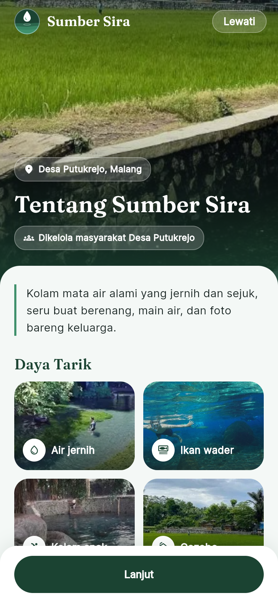 | 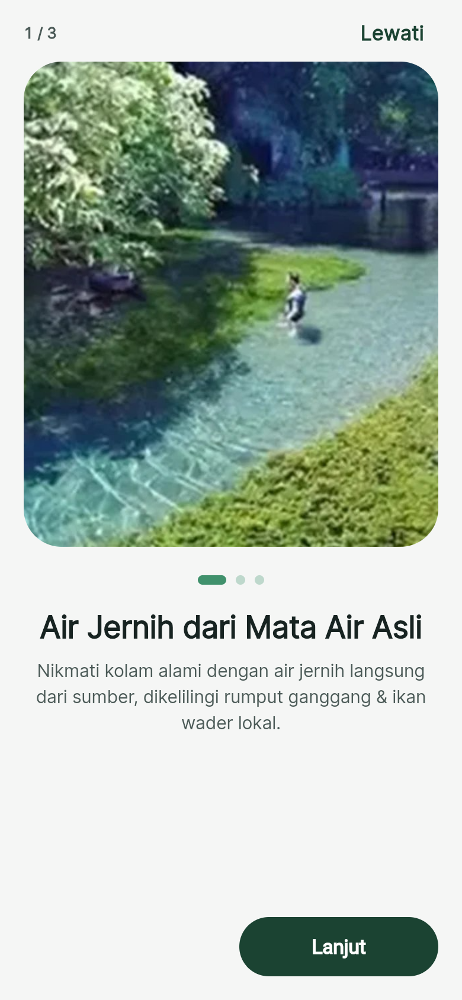 |  |

| Tanya Sira (mengambang di Beranda) | Tiket & Booking (riwayat per WhatsApp) | Sewa & Booking (di bawah Tiket Saya) |
|---|---|---|
| 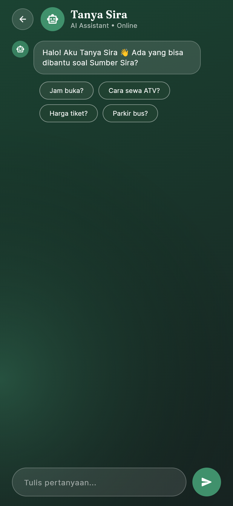 | 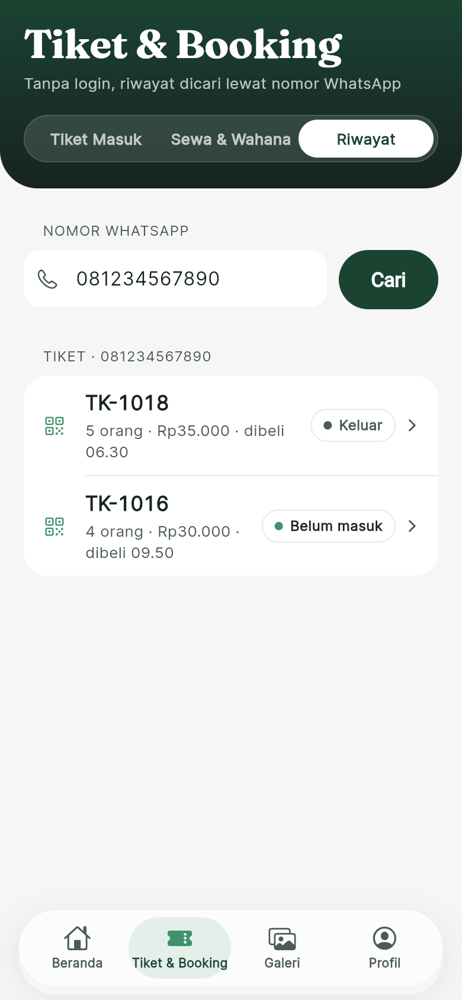 |  |

| Beli tiket | E-Tiket | Checkout |
|---|---|---|
|  | 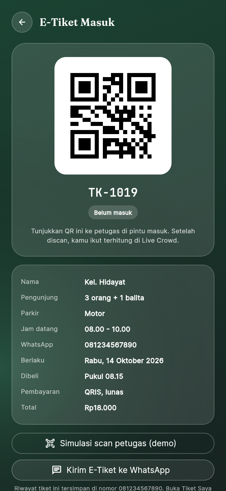 | 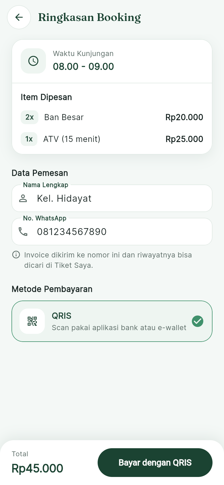 |

| Bayar QRIS | Booking Berhasil & Invoice | Galeri |
|---|---|---|
| 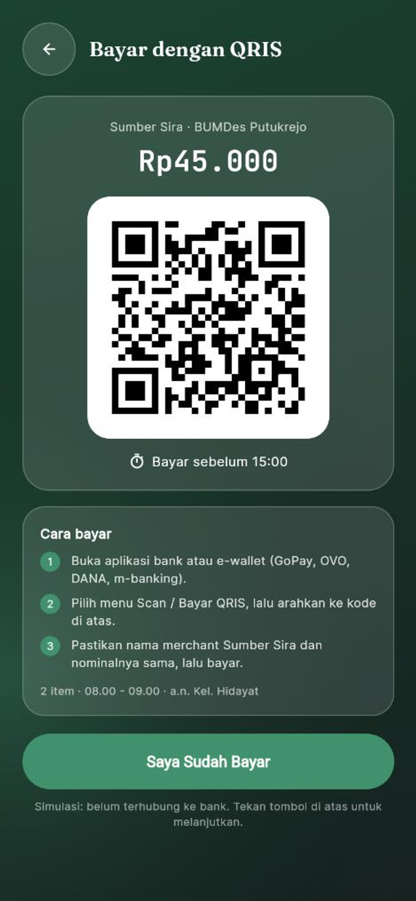 | 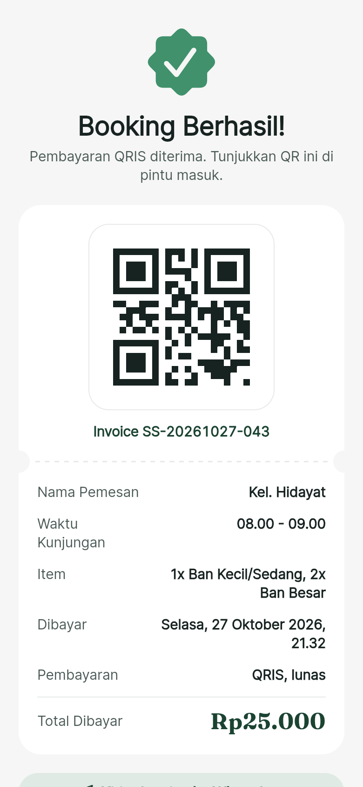 | 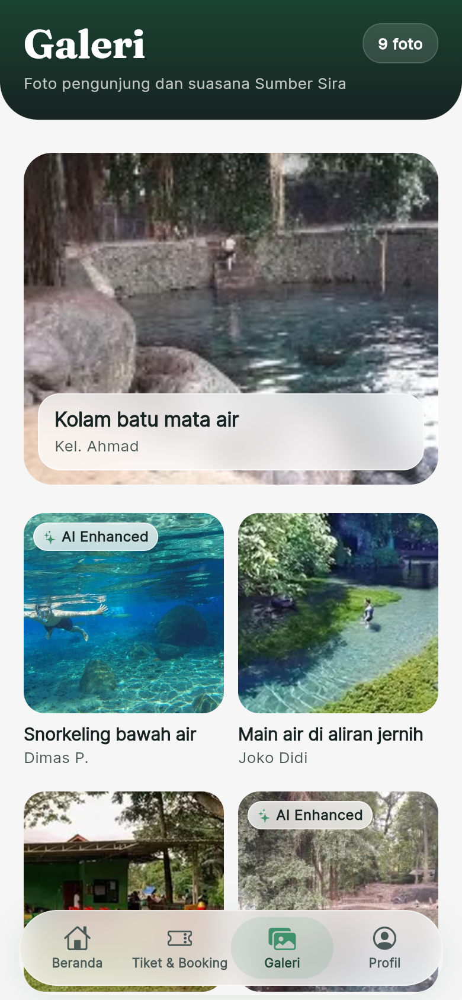 |

| Ulasan & Rating | Profil | AI Photo Studio |
|---|---|---|
| 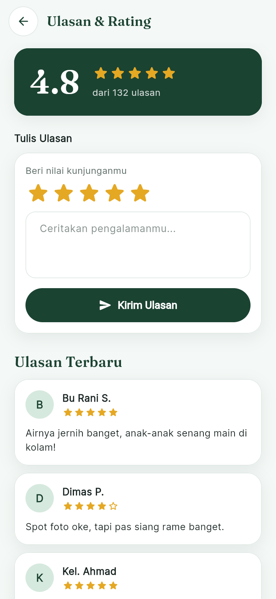 | 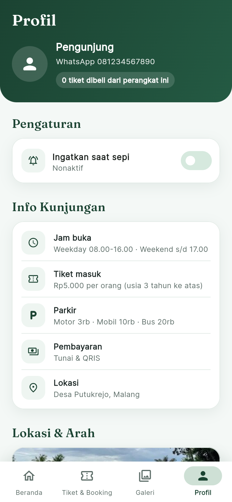 | 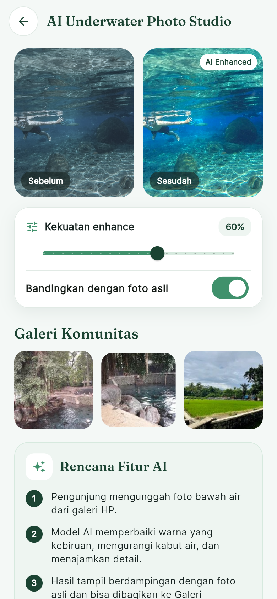 |

Ekspor desain Figma lengkap ada di folder `desain/`.

## Halaman

### Panel admin

| Rute | Halaman |
|---|---|
| `/admin/login` | Masuk admin. Semua halaman `/admin` lain wajib login, tombol keluar ada di kartu profil sidebar |
| `/admin/akun` | Akun & Sesi: profil, hak akses, daftar sesi login aktif milik akun ini, cabut sesi perangkat lain |
| `/admin` | Dashboard Overview (kartu ringkasan, grafik batang pill beranimasi, Insight AI, booking masuk, heatmap keramaian seminggu, tiket online hari ini, wahana terpopuler, pendapatan 7 hari) |
| `/admin/booking` | Booking Sewa & Wahana (filter, cari lewat kotak cari di header, detail booking, konfirmasi/tolak) |
| `/admin/tiket` | Tiket & Check-in (tambahan): scan kode tiket di pintu masuk, daftar tiket hari ini, check-in dan keluar |
| `/admin/insight` | AI Insight (grafik area prediksi, ringkasan AI, donat sentimen, batang keluhan, ulasan terbaru) |
| `/admin/galeri` | Galeri & Konten (moderasi foto, urut terbaru/terlama, tampilan grid atau daftar) |
| `/admin/faq` | Chatbot & FAQ (tambah, edit, hapus, jawab pertanyaan pengunjung) |
| `/admin/wahana` | Wahana & Harga (filter kategori, tambah, edit, hapus) |

Tampilan admin mengikuti desain admin terbaru di Figma: sidebar berupa kartu putih yang melayang, menu aktif
berbentuk pill Hijau Tua, kartu statistik membulat dengan ikon di dalam lingkaran, grafik batang berbentuk pill,
baris tabel membulat, dan status berbentuk pill. Warnanya tetap dua hijau yang sama.

### Tiket online dan Live Crowd

Angka Live Crowd dihitung dari tiket masuk online: jumlah orang dari tiket yang sudah discan di pintu masuk dan
belum keluar, dibagi kapasitas 300 orang (di bawah 40% Sepi, sampai 75% Sedang, di atasnya Ramai).
Karena belum ada backend, web admin menyimpan tiket di `localStorage` browser (`src/lib/tiket-store.ts`) dan aplikasi
Flutter menyimpan data contoh di memori, sedangkan tiket dan booking yang dibeli lewat aplikasi disimpan di perangkat
dengan `shared_preferences` dan dikelompokkan per nomor WhatsApp (`mobile/lib/data/app_state.dart`).

Cara demo di web admin: buka `/admin/tiket`, ketik kode tiket yang masih "Belum masuk" (mis. `1036`) lalu tekan Check-in.
Angka di halaman Tiket dan dashboard langsung naik. Tombol "Kembalikan data contoh hari ini" mengembalikan data awal.
Di aplikasi Flutter: beli tiket, lalu tekan "Simulasi scan petugas" di e-tiket.

## Autentikasi & Otorisasi Admin (Pertemuan 9)

Login hanya ada di panel admin. Aplikasi pengunjung (Flutter) tidak memakai login.
Autentikasi = membuktikan siapa yang masuk (email + password). Otorisasi = menentukan apa yang boleh dilakukan
akun itu (peran admin atau petugas).

| Materi | Penerapan | Letak |
|---|---|---|
| Hash password | Password disimpan sebagai hash scrypt + salt, dibandingkan dengan `timingSafeEqual` | `src/lib/auth/users.ts` |
| Session berbasis server | Server menyimpan sesi, browser hanya memegang ID acak (yang disimpan server adalah hash-nya). ID baru setiap login, sesi bisa dicabut seketika | `src/lib/auth/session.ts` |
| Cookie aman | `HttpOnly`, `Secure`, `SameSite=Lax`. "Ingat saya" = 7 hari, tanpa itu cookie hilang saat browser ditutup (maks 8 jam) | `createSession()` di `session.ts` |
| Login lewat Server Action | Validasi isian, batas 5 kali salah lalu dikunci 1 menit, pesan error sama untuk email/password salah | `src/lib/auth/actions.ts`, `src/app/admin/login/` |
| proxy.ts | Cek kasar: tanpa cookie sesi diarahkan ke `/admin/login?next=...`. Cookie ada belum tentu valid | `src/proxy.ts` |
| DAL (Data Access Layer) | Satu pintu cek sesi dan peran: `server-only`, `cache()`, data admin dikirim tanpa hash password | `src/lib/auth/dal.ts` |
| Layout / page | Layout `(panel)` hanya mengambil data untuk sidebar; setiap `page.tsx` cek izin sendiri lewat DAL | `src/app/admin/(panel)/` |
| RBAC | Peran `admin` dan `petugas` dengan daftar izin. Menu sidebar disaring sesuai peran (hanya tampilan) | `src/lib/auth/roles.ts`, `Sidebar.tsx` |
| 401 vs 403 | Belum login: dialihkan ke login, API membalas 401. Sudah login tapi tidak berizin: halaman 403 (`forbidden()`) | `dal.ts`, `(panel)/forbidden.tsx`, `src/app/api/admin/me/route.ts` |
| Server Action khusus admin | Tambah/edit/hapus wahana: autentikasi, otorisasi, validasi, ubah data, revalidasi. Ditolak = `FORBIDDEN` bertipe | `src/app/admin/(panel)/wahana/actions.ts` |
| Query terbatas (cegah IDOR) | Daftar dan pencabutan sesi hanya untuk sesi milik akun yang login; sesi akun lain dianggap tidak ada | `listSessionsOf()` dan `revokeSessionOf()` di `session.ts` |
| Open redirect | `?next=` hanya boleh halaman di dalam `/admin` | `src/lib/auth/redirect.ts` |

Cara mencoba:

1. Buka `/admin/wahana` tanpa login: diarahkan ke login, setelah masuk kembali ke Wahana.
2. Masuk sebagai Petugas: sidebar hanya 4 menu. Buka `/admin/insight` lewat alamat langsung: halaman 403.
3. Masih sebagai Petugas, tekan hapus atau edit di Wahana & Harga: server menolak dengan `403 FORBIDDEN`.
4. Masuk sebagai Admin: semua menu terbuka dan harga bisa diubah.
5. DevTools, tab Application, lalu Cookies: cookie `ss_admin_session` bertanda HttpOnly, Secure, SameSite Lax.
6. Buka `/api/admin/me` tanpa login: `401`. Halaman Akun & Sesi: cabut sesi perangkat lain, perangkat itu langsung keluar.

Catatan tahap ini: sesi dan data wahana disimpan di memori server (hilang bila server dimatikan) karena belum ada database.
Login Google (OAuth) dan MFA belum dibuat karena butuh akun penyedia (Google Cloud) dan database.

## Syarat dosen dan letaknya

| Syarat | Implementasi |
|---|---|
| Gunakan Next.js | Next.js 16 App Router + TypeScript (`src/app`) |
| UTS fokus frontend web, minimal 3 slide (admin) | 6 halaman admin di `src/app/admin` |
| Animasi grafik di admin | `src/components/charts/`: batang pill tumbuh dari bawah (`BarChart`), garis prediksi digambar kiri ke kanan (`AreaChart`), donat sentimen muncul (`DonutChart`), batang keluhan mengisi (`ProgressBar`) |
| Introduction web | `src/app/(intro)/page.tsx` |
| Tiap section halaman jadi file sendiri (Pertemuan 10) | Folder `components/` di dalam folder tiap halaman, `page.tsx` hanya menyusun section |

## Struktur folder

```
mobile/                Aplikasi pengunjung (Flutter), lihat bagian Aplikasi Mobile
desain/                PNG ekspor dari Figma (acuan tampilan: mobile 2×, admin 1,25×)
  foto/                Foto asli Sumber Sira yang dipakai aplikasi (di-import lewat src/lib/foto.ts)
src/app/               Halaman (App Router). Tiap halaman punya folder components/ berisi section-nya,
                       page.tsx hanya menyusun section. Folder (nama) = route group, tidak mengubah alamat
  (intro)/             Intro web, alamat /
    page.tsx
    components/        Hero, Fitur, InfoKunjungan, Footer
  admin/login/         Halaman login admin, alamat /admin/login
    page.tsx           Server: cek sesi lalu susun section
    components/        LoginBackdrop, LoginIntro, LoginWidgets, BrandMobile, LoginForm, WidgetTablet
  admin/(panel)/       Halaman admin yang wajib login: layout sidebar, forbidden.tsx (403), tiap page.tsx cek izin lewat DAL
    (dashboard)/       Dashboard, alamat /admin
      page.tsx
      components/      StatRingkasan, LiveCrowdMonitor, InsightAi, BookingMasuk, PolaKeramaian, TiketHariIni,
                       WahanaPopuler, PendapatanMingguan, LiveCrowdStat, Today
    booking/components/  BookingView (data + pilihan), StatBooking, DaftarBooking, DetailBooking
    tiket/components/    TiketView, StatTiket, ScanTiket, CheckinTerbaru, DaftarTiket
    insight/components/  CrowdForecast, RingkasanAi, SentimenUlasan, KeluhanTeratas, UlasanTerbaru
    galeri/components/   GaleriView, StatGaleri, ToolbarGaleri, FotoGrid, FotoList, AiBadge, AksiFoto
    faq/components/      FaqView, StatFaq, DaftarFaq, BelumTerjawab, FormFaq
    wahana/components/   WahanaView, PesanAkses, StatWahana, DaftarWahana, FormWahana (Server Action di wahana/actions.ts)
    akun/components/     Profil, SesiLogin, SesiList
  api/admin/me/        Route Handler contoh yang dilindungi (401 bila belum login)
src/proxy.ts           Cek kasar cookie sesi sebelum masuk /admin (dulu middleware.ts)
src/components/        Komponen yang dipakai banyak halaman
  charts/              BarChart, AreaChart, DonutChart, Heatmap (admin), ProgressBar (beranimasi)
  admin/               AdminShell, Sidebar (menu sesuai peran), ui.tsx (AdminHeader, Card, StatCard, ...)
  Logo.tsx              Logo Sumber Sira (tetes air + sawah bertingkat), juga dipakai di src/app/icon.svg
  WahanaIcon.tsx        Ikon per wahana
src/data/              Data dummy (wahana.ts, dummy.ts). Tahap backend: ganti dengan data API
src/lib/
  tiket-store.ts       Tiket masuk online + angka Live Crowd (disimpan di localStorage)
  auth/                Autentikasi & otorisasi admin: users.ts (hash password), session.ts (sesi + cookie),
                       dal.ts (Data Access Layer), roles.ts (peran dan izin), actions.ts (login, logout, cabut sesi)
  server/wahana-store.ts  Data wahana di server untuk Server Action khusus admin
  whatsapp.ts          Pesan invoice WhatsApp
  format.ts            Format Rupiah dan kode booking
  foto.ts              Import semua foto aplikasi dari desain/foto
```

## Catatan desain

- Ukuran mengikuti Figma: frame mobile **375 × 812** dan admin **1440 × 900**. PNG mobile di `desain/`
  diekspor 2× (1 px di kode = 2 px di PNG), PNG admin diekspor 1,25× (1 px di kode = 1,25 px di PNG).
  Ukuran teks, jarak, dan kartu diukur dari PNG.
- Tampilan mobile memakai tema terang seperti aplikasi wisata dan booking pada umumnya: header hijau tua di setiap tab,
  isi berupa kartu putih di latar hijau sangat muda, foto besar untuk bagian informatif, nomor langkah di form, dan tombol aksi
  yang menempel di bawah. Teks minimal 11 px (isi 13-14 px) dan tombol minimal 44 px supaya nyaman disentuh.
  Warna tambahan (`surface`, `mint`, `pale`, `line`, `muted`, `sun` untuk status Sedang dan bintang) ada di `mobile/lib/theme/app_theme.dart`.
- Warna dan font ada di `src/app/globals.css` (`@theme`): `forest` dan `leaf` (hanya dua hijau, sama dengan papan Color Palette di Figma), `ink`, `paper`, `coral`. Warna yang lebih muda dibuat dengan transparansi, mis. `bg-leaf/15`, bukan token baru.
  Pakai lewat kelas Tailwind, misalnya `bg-forest` dan `text-leaf`.
- Font dipasang dari npm (Fontsource): Fraunces (judul), Inter (teks), JetBrains Mono (angka/harga).
- Foto aplikasi ada di `desain/foto/` (folder `public/` tidak dipakai lagi) dan di-import lewat `src/lib/foto.ts`,
  jadi Next.js memprosesnya sebagai gambar statis. Foto baru: taruh di `desain/foto/`, lalu tambahkan di `foto.ts`. Semua foto adalah foto asli Sumber Sira; foto galeri admin
  memakai foto yang sama dengan potongan berbeda (`pos` di `src/data/dummy.ts`).
- Logo Sumber Sira ada di `src/components/Logo.tsx` (sidebar dan login admin, intro web), versi Flutter di `mobile/lib/widgets/logo_mark.dart`,
  dan sebagai ikon tab browser di `src/app/icon.svg`.
- Yang tidak ada di Figma dan sengaja ditambahkan: halaman intro web, pesan validasi form, dan modal Tambah/Edit di admin.

## Masih simulasi dan perlu dikerjakan di tahap backend

| Fitur | Sekarang (frontend) | Tahap backend |
|---|---|---|
| Data (wahana, booking, keramaian, FAQ, ulasan, galeri) | Konstanta di `src/data/` | Ambil dari API/database |
| Booking & pembayaran | Kode booking dibuat di browser, pembayaran tidak diproses | Simpan booking di server. QRIS lewat payment gateway |
| AI Photo enhance | Filter warna sebagai simulasi (aplikasi Flutter) | Kirim foto ke layanan AI, tampilkan hasilnya |
| Tiket online & Live Crowd | Tiket disimpan di `localStorage` (web admin) dan di perangkat lewat `shared_preferences` (Flutter), pembayaran QRIS disimulasikan | Simpan tiket di database, scan QR lewat aplikasi petugas, Live Crowd dihitung server |
| Riwayat per WhatsApp | Dicari dari data di perangkat, e-tiket dibuka di WhatsApp lewat tautan `wa.me` | Server mengirim e-tiket otomatis lewat WhatsApp Business API, riwayat dibuka setelah verifikasi kode OTP ke nomor itu |
| Login admin | Akun dicek di server (hash scrypt), sesi di memori server, cookie HttpOnly + Secure + SameSite, peran admin/petugas | Akun dan sesi disimpan di database/Redis, tambah login Google (OAuth) dan MFA untuk akun admin |

**Keamanan untuk tahap backend:**

- Semua API key (WhatsApp, payment gateway, AI) disimpan di environment variable server, misalnya
  `.env.local`. **Jangan** taruh di kode frontend dan **jangan** commit ke git. `.env*` sudah ada di `.gitignore`.
- Pakai kredensial dengan hak akses seminimal mungkin.
- Jangan menulis API key atau data pribadi pengunjung (nomor WhatsApp, dll.) ke log.

## Kerja kelompok dengan Git

1. Clone repo, lalu `npm install`.
2. Buat branch per fitur: `git checkout -b fitur/nama-fitur`.
3. Commit kecil-kecil dengan pesan jelas, lalu `git push -u origin fitur/nama-fitur`.
4. Buka Pull Request ke `main` dan minta teman sekelompok me-review sebelum merge.
5. Sebelum push, jalankan `npm run lint` dan `npm run build` supaya tidak ada error.
