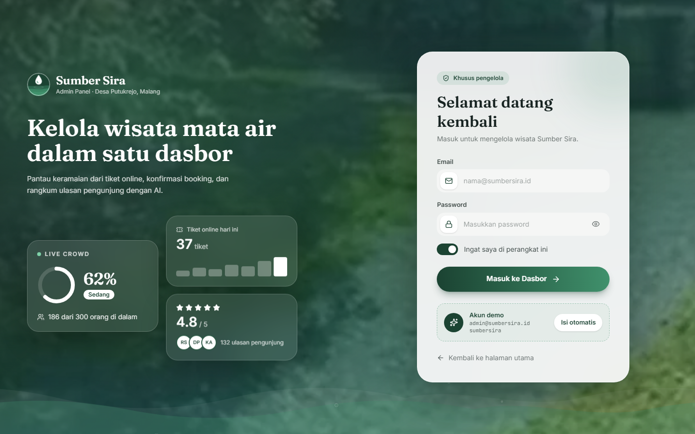
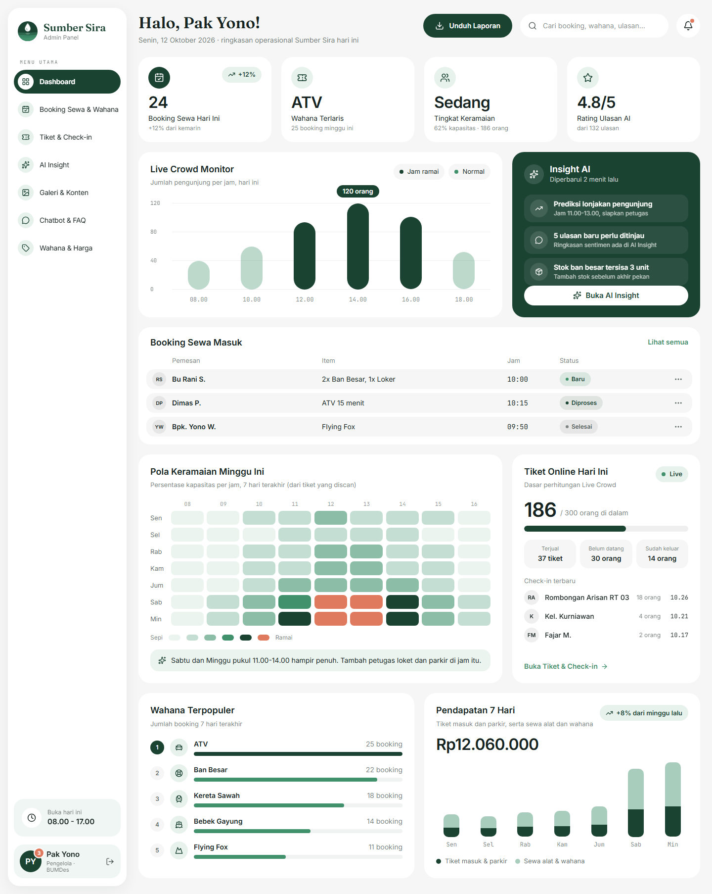
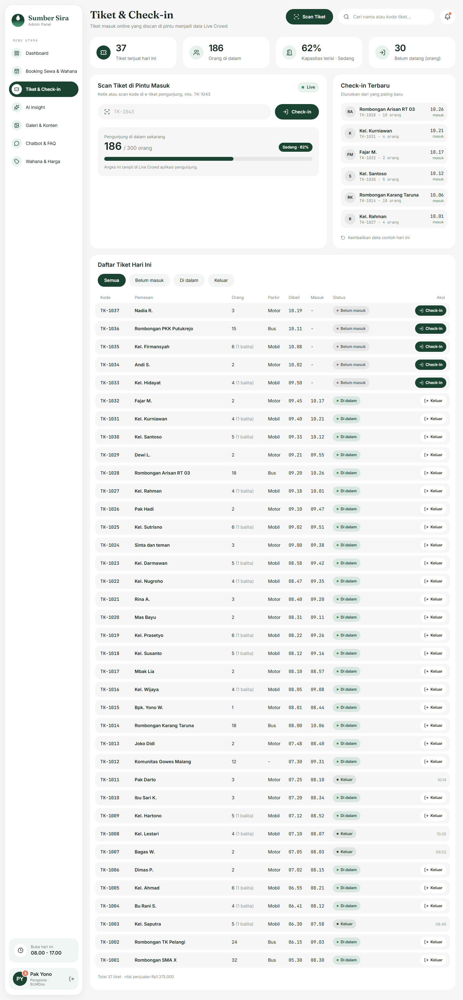
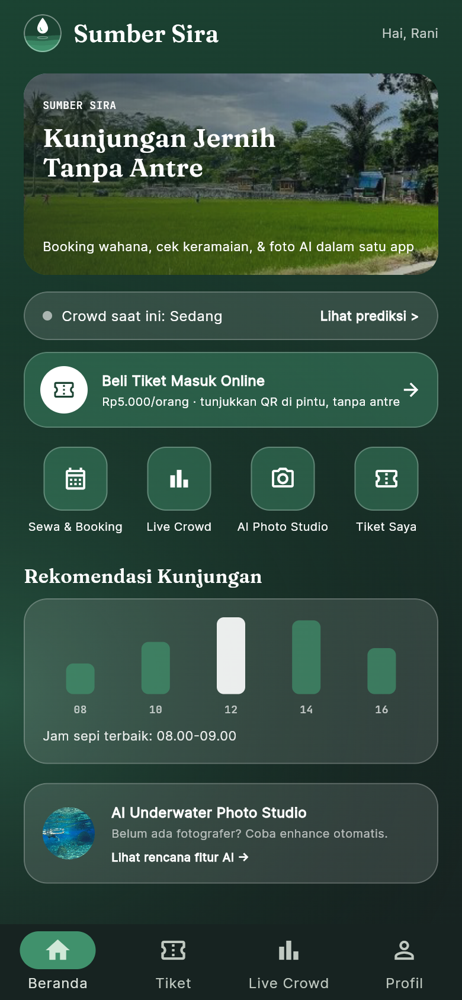
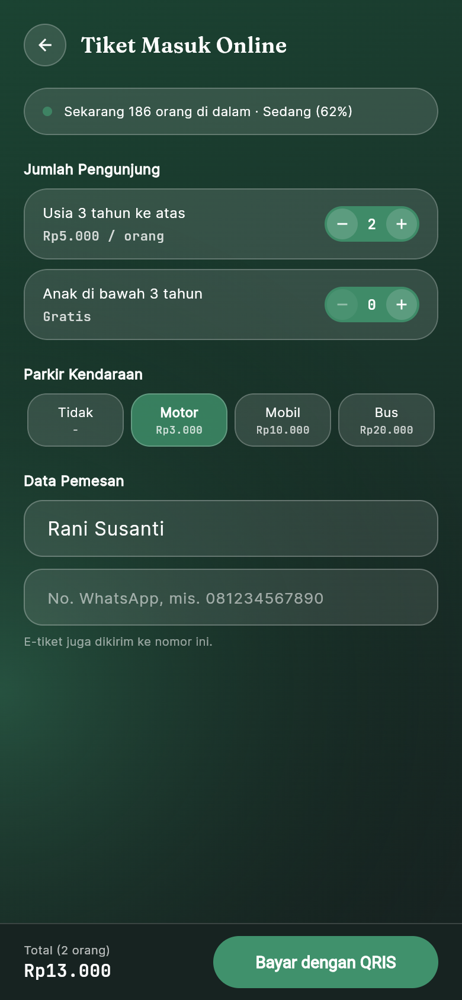
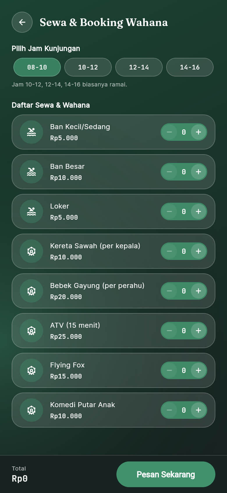

# Sumber Sira · Aplikasi Mobile & Web Admin

Tugas kelompok (UTS, fokus frontend). Satu rancangan sistem dengan dua antarmuka, dari desain Figma **HI-FI** Sumber Sira:

| Bagian | Pengguna | Teknologi | Folder |
|---|---|---|---|
| **Mobile Application** | Pengunjung | **Flutter** (Dart) | `mobile/` |
| **Dashboard Web** | Admin / pengelola | **Next.js 16 (App Router) + TypeScript + Tailwind CSS 4** | `src/` |

Versi web aplikasi pengunjung (`/app`) tetap ada di Next.js sebagai pembanding desain.

Sumber Sira adalah wisata kolam mata air di Desa Putukrejo, Malang. Aplikasi ini untuk booking sewa alat
dan wahana, cek keramaian, foto AI bawah air, chatbot, dan ulasan. Panel admin dipakai pengelola.

## Menjalankan

Butuh Node.js 20 atau lebih baru.

```bash
npm install
npm run dev
```

Buka <http://localhost:3000>:

| Alamat | Isi |
|---|---|
| `/` | Halaman perkenalan web (introduction web) |
| `/app` | Aplikasi pengunjung, mulai dari splash. Paling pas dibuka di DevTools mode ponsel (375 × 812) |
| `/admin` | Panel admin (wajib login, lihat akun demo di bawah). Desainnya untuk layar 1440 × 900 |

**Akun demo admin** (tahap frontend, belum ada backend): email `admin@sumbersira.id`, password `sumbersira`.
Di halaman login juga ada tombol "Isi otomatis".

Perintah lain:

- `npm run build` untuk build produksi, `npm start` untuk menjalankan hasil build.
- `npm run lint` untuk ESLint.
- `npm run dev:turbo` untuk mode dev Turbopack. Lebih cepat, tetapi lihat catatan di bawah.

> **Kenapa `npm run dev` memakai webpack?** Kalau path folder proyek mengandung spasi
> (misalnya `D:\Tugas\Sumber Sira`), mode dev Turbopack kadang tidak memperbarui CSS Tailwind
> setelah file diubah. Kelas baru jadi tidak berpengaruh sampai server di-restart. Mode webpack
> tidak punya masalah ini. Kalau folder kamu tanpa spasi, `npm run dev:turbo` juga aman.

## Aplikasi Mobile (Flutter)

Butuh Flutter SDK 3.4x atau lebih baru.

```bash
cd mobile
flutter pub get
flutter run            # pilih perangkat: Android, Chrome, atau Windows
flutter test           # uji format Rupiah, validasi form, dan Live Crowd
flutter build web      # hasil build ada di mobile/build/web
```

Aplikasi pengunjung **tanpa login**: dari Splash langsung masuk ke Beranda. Login hanya ada di web admin.

| Layar | File | Isi |
|---|---|---|
| Splash | `screens/splash_screen.dart` | Foto bergerak, riak air dari logo, garis loading, lanjut otomatis 3,2 detik ke Beranda |
| Beranda | `screens/home_tab.dart` | Banner, status keramaian, tombol beli tiket, menu cepat, rekomendasi jam |
| Form beli tiket | `screens/ticket_form_screen.dart` | Jumlah pengunjung, parkir, nama, WhatsApp (divalidasi), bayar QRIS (simulasi) |
| E-Tiket (hasil input) | `screens/eticket_screen.dart` | QR tiket, status, detail, simulasi scan petugas |
| Tiket Saya | `screens/tickets_tab.dart` | Daftar tiket yang sudah dibeli |
| Live Crowd | `screens/crowd_tab.dart` | Persen keramaian dari tiket yang discan + prediksi per jam |
| Sewa & Booking | `screens/booking_screen.dart` | Daftar wahana dari mock JSON `assets/data/wahana.json` |
| AI Photo Studio | `screens/ai_photo_screen.dart` | Rancangan fitur AI (belum diimplementasikan) |
| Profil | `screens/profile_tab.dart` | Ringkasan pengunjung dan info wisata |

Struktur `mobile/lib`: `screens/` (layar), `widgets/` (komponen yang dipakai ulang: kartu kaca, logo bergerak, grafik,
stepper), `models/` (Ticket, Wahana), `data/` (data contoh dan `AppState` berbasis ChangeNotifier), `theme/` (warna dan font),
`utils/` (rute, format Rupiah, validasi). Package: `google_fonts` (Fraunces, Inter, JetBrains Mono) dan `qr_flutter` (kode QR).
Responsif: isi halaman bisa digulir, lebar maksimal 480 px di tengah untuk tablet/web, ukuran mengikuti layar lewat
`Expanded`, `Wrap`, `LayoutBuilder`, dan `SafeArea`, jadi tidak ada overflow saat layar kecil atau landscape.

## Rancangan Fitur AI

**AI Underwater Photo Studio.** Di lokasi belum ada fotografer, sementara foto bawah air biasanya kebiruan dan buram.
Rencananya pengunjung mengunggah foto, lalu model *image enhancement* bawah air memperbaiki warna, mengurangi kabut air,
dan menajamkan detail. Hasilnya tampil berdampingan dengan foto asli dan bisa dibagikan ke Galeri Komunitas (dimoderasi
admin di halaman Galeri & Konten). Tahap UTS hanya menampilkan rancangan dan simulasi filter warna, belum memakai model atau API AI.
Fitur AI lain yang sudah dirancang tampilannya: prediksi keramaian (AI Insight di admin) dan chatbot Tanya Sira.

## Pemenuhan Soal UTS

| Ketentuan | Dashboard Web (Next.js + TypeScript) | Mobile Application (Flutter) |
|---|---|---|
| Halaman login (simulasi) | `/admin/login` | Tidak memakai login (pengunjung langsung masuk dari Splash) |
| Dashboard / halaman utama | `/admin` | `home_tab.dart` |
| Data berbentuk tabel atau kartu | Tabel booking, tiket, wahana; kartu ringkasan | Kartu tiket, daftar wahana |
| Pengelolaan data / form input | `/admin/wahana` (tambah, edit, hapus), `/admin/faq`, `/admin/tiket` | `ticket_form_screen.dart` |
| Halaman hasil input | Tabel ikut berubah setelah aksi | `eticket_screen.dart`, `tickets_tab.dart` |
| Navigasi dan validasi | Sidebar, redirect login, validasi form | Named routes, tab bawah, validasi nama dan WhatsApp |
| Data | Data contoh + `localStorage` | Data contoh + mock JSON |
| Rancangan AI | Lihat bagian Rancangan Fitur AI | Layar AI Photo Studio |

## Screenshot

| Login admin | Dashboard admin | Tiket & Check-in |
|---|---|---|
|  |  |  |

| Beranda (Flutter) | Beli tiket (Flutter) | Booking (Flutter) |
|---|---|---|
|  |  |  |

Ekspor desain Figma lengkap ada di folder `desain/`.

## Halaman

### Aplikasi pengunjung

| Rute | Layar Figma |
|---|---|
| `/app` | Splash (otomatis lanjut ke Tentang setelah 2,6 detik, atau ketuk) |
| `/app/tentang` | Tentang Sumber Sira (introduction app) |
| `/app/onboarding` | Onboarding 1-3: bisa digeser (swipe/drag) **dan** pakai tombol Kembali/Lanjut |
| `/app/home` | Home |
| `/app/booking` | Booking Sewa & Wahana |
| `/app/checkout` | Checkout (Ringkasan Booking) |
| `/app/konfirmasi` | Konfirmasi & E-Voucher (QR + kirim invoice ke WhatsApp) |
| `/app/crowd` | Live Crowd Tracker (AI) |
| `/app/ai-photo` | AI Underwater Photo Studio |
| `/app/chat` | Chatbot Tanya Sira |
| `/app/ulasan` | Ulasan & Rating |
| `/app/tiket` | Tiket masuk online (tambahan, belum ada di Figma): pilih jumlah orang dan parkir, bayar QRIS, dapat e-tiket |
| `/app/tiket/[kode]` | E-tiket QR, statusnya ikut berubah saat discan petugas |

### Panel admin

| Rute | Halaman |
|---|---|
| `/admin/login` | Masuk admin (tambahan). Semua halaman `/admin` lain wajib login, tombol keluar ada di kartu profil sidebar |
| `/admin` | Dashboard Overview (kartu ringkasan, grafik batang pill beranimasi, Insight AI, booking masuk, heatmap keramaian seminggu, tiket online hari ini, wahana terpopuler, pendapatan 7 hari) |
| `/admin/booking` | Booking Sewa & Wahana (filter, cari lewat kotak cari di header, detail booking, konfirmasi/tolak) |
| `/admin/tiket` | Tiket & Check-in (tambahan): scan kode tiket di pintu masuk, daftar tiket hari ini, check-in dan keluar |
| `/admin/insight` | AI Insight (grafik area prediksi, ringkasan AI, donat sentimen, batang keluhan, ulasan terbaru) |
| `/admin/galeri` | Galeri & Konten (moderasi foto, urut terbaru/terlama, tampilan grid atau daftar) |
| `/admin/faq` | Chatbot & FAQ (tambah, edit, hapus, jawab pertanyaan pengunjung) |
| `/admin/wahana` | Wahana & Harga (filter kategori, tambah, edit, hapus) |

Tampilan admin mengikuti desain admin terbaru di Figma: sidebar berupa kartu putih yang melayang, menu aktif
berbentuk pill Hijau Tua, kartu statistik membulat dengan ikon di dalam lingkaran, grafik batang berbentuk pill,
baris tabel membulat, dan status berbentuk pill. Warnanya tetap dua hijau yang sama.

### Tiket online dan Live Crowd

Angka Live Crowd dihitung dari tiket masuk online: jumlah orang dari tiket yang sudah discan di pintu masuk dan
belum keluar, dibagi kapasitas 300 orang (di bawah 40% Sepi, sampai 75% Sedang, di atasnya Ramai).
Karena belum ada backend, tiket disimpan di `localStorage` browser (`src/lib/tiket-store.ts`), jadi aplikasi
pengunjung dan admin di browser yang sama memakai data yang sama, termasuk antar-tab.

Cara demo: buka `/app/tiket` di satu tab, beli tiket (pembayaran QRIS disimulasikan), lalu buka `/admin/tiket` di
tab lain dan masukkan kode tiketnya (mis. `TK-1038` atau cukup `1038`). E-tiket berubah jadi "Di dalam" dan angka di
Live Crowd, Home, dan dashboard admin langsung naik. Tombol "Kembalikan data contoh hari ini" mengembalikan data awal.

## Syarat dosen dan letaknya

| Syarat | Implementasi |
|---|---|
| Gunakan Next.js | Next.js 16 App Router + TypeScript (`src/app`) |
| UTS fokus frontend web, minimal 3 slide (admin) | 6 halaman admin di `src/app/admin` |
| Animasi grafik di admin | `src/components/charts/`: batang pill tumbuh dari bawah (`BarChart`), garis prediksi digambar kiri ke kanan (`AreaChart`), donat sentimen muncul (`DonutChart`), batang keluhan mengisi (`ProgressBar`) |
| Onboarding pakai tombol atau swipe | `src/app/app/onboarding/page.tsx`: keduanya ada, plus tombol titik dan panah keyboard |
| Introduction web dan app | Web: `src/app/page.tsx`. App: splash + `src/app/app/tentang/page.tsx` |
| Setelah bayar, invoice terkirim ke WhatsApp user | `src/lib/whatsapp.ts` + halaman konfirmasi. Lihat bagian "Tahap backend" |

## Struktur folder

```
desain/                PNG ekspor dari Figma (acuan tampilan: mobile 2×, admin 1,25×)
  foto/                Foto asli Sumber Sira yang dipakai aplikasi (di-import lewat src/lib/foto.ts)
src/app/               Halaman (App Router)
  page.tsx              Intro web
  app/                 Aplikasi pengunjung (layout lebar maks 430 px)
  admin/               Panel admin (layout sidebar)
src/components/
  charts/              BarChart, AreaChart, DonutChart, Heatmap (admin), LineChart (mobile), ProgressBar (beranimasi)
  mobile/              PageHeader, BottomNav
  admin/               AdminShell (cek login), Sidebar, DashboardLive, Today, ui.tsx (AdminHeader, Card, StatCard, ...)
  mobile/LiveCrowd.tsx  Pill, kartu, dan banner Live Crowd yang ikut data tiket
  Logo.tsx              Logo Sumber Sira (tetes air + sawah bertingkat), juga dipakai di src/app/icon.svg
  WahanaIcon.tsx        Ikon per wahana
src/data/              Data dummy (wahana.ts, dummy.ts). Tahap backend: ganti dengan data API
src/lib/
  booking-context.tsx   Keranjang booking (disimpan di sessionStorage)
  tiket-store.ts       Tiket masuk online + angka Live Crowd (disimpan di localStorage)
  admin-auth.ts        Login admin dengan akun demo (simulasi frontend)
  whatsapp.ts          Pesan invoice WhatsApp
  format.ts            Format Rupiah dan kode booking
  foto.ts              Import semua foto aplikasi dari desain/foto
```

## Catatan desain

- Ukuran mengikuti Figma: frame mobile **375 × 812** dan admin **1440 × 900**. PNG mobile di `desain/`
  diekspor 2× (1 px di kode = 2 px di PNG), PNG admin diekspor 1,25× (1 px di kode = 1,25 px di PNG).
  Ukuran teks, jarak, dan kartu diukur dari PNG. Teks mobile memang kecil (9-13 px) karena begitu di desain. Kalau mau diperbesar demi keterbacaan,
  diskusikan dulu dengan kelompok supaya tetap konsisten.
- Warna dan font ada di `src/app/globals.css` (`@theme`): `forest` dan `leaf` (hanya dua hijau, sama dengan papan Color Palette di Figma), `ink`, `paper`, `coral`. Warna yang lebih muda dibuat dengan transparansi, mis. `bg-leaf/15`, bukan token baru.
  Pakai lewat kelas Tailwind, misalnya `bg-forest` dan `text-leaf`.
- Font dipasang dari npm (Fontsource): Fraunces (judul), Inter (teks), JetBrains Mono (angka/harga).
- Foto aplikasi ada di `desain/foto/` (folder `public/` tidak dipakai lagi) dan di-import lewat `src/lib/foto.ts`,
  jadi Next.js memprosesnya sebagai gambar statis. Foto baru: taruh di `desain/foto/`, lalu tambahkan di `foto.ts`. Semua foto adalah foto asli Sumber Sira; foto galeri admin
  memakai foto yang sama dengan potongan berbeda (`pos` di `src/data/dummy.ts`).
- Logo Sumber Sira ada di `src/components/Logo.tsx` (Splash, header Home dan Tentang, sidebar admin, intro web)
  dan sebagai ikon tab browser di `src/app/icon.svg`.
- Yang tidak ada di Figma dan sengaja ditambahkan: halaman intro web, tombol "Kirim Invoice ke WhatsApp",
  pesan validasi form, stepper jumlah di Booking, dan modal Tambah/Edit di admin.
- Ikon profil di navigasi bawah sementara menuju Ulasan & Rating, karena halaman Profil belum didesain.

## Masih simulasi dan perlu dikerjakan di tahap backend

| Fitur | Sekarang (frontend) | Tahap backend |
|---|---|---|
| Invoice WhatsApp | Tombol membuka `wa.me` dengan teks invoice terisi otomatis | Buat `POST /api/invoice` yang mengirim otomatis lewat WhatsApp Cloud API (Meta) atau gateway. Panggil setelah pembayaran sukses |
| Data (wahana, booking, keramaian, FAQ, ulasan, galeri) | Konstanta di `src/data/` | Ambil dari API/database |
| Booking & pembayaran | Kode booking dibuat di browser, pembayaran tidak diproses | Simpan booking di server. QRIS lewat payment gateway |
| AI Photo enhance | Filter CSS sebagai simulasi | Kirim foto ke layanan AI, tampilkan hasilnya |
| Chatbot Tanya Sira | Jawaban berdasar kata kunci | Hubungkan ke data FAQ admin dan/atau layanan AI |
| Tiket online & Live Crowd | Tiket dan scan disimpan di `localStorage` browser, pembayaran QRIS disimulasikan | Simpan tiket di database, scan QR lewat aplikasi petugas, Live Crowd dihitung server |
| Login admin | Akun demo dicek di browser, sesi di `localStorage`/`sessionStorage` (hanya simulasi tampilan) | Cek akun di server, sesi di cookie httpOnly, lindungi `/admin` di server, jangan simpan password di kode |

**Keamanan untuk tahap backend:**

- Semua API key (WhatsApp, payment gateway, AI) disimpan di environment variable server, misalnya
  `.env.local`. **Jangan** taruh di kode frontend dan **jangan** commit ke git. `.env*` sudah ada di `.gitignore`.
- Pakai kredensial dengan hak akses seminimal mungkin.
- Jangan menulis API key atau data pribadi pengunjung (nomor WhatsApp, dll.) ke log.

## Kerja kelompok dengan Git

1. Clone repo, lalu `npm install`.
2. Buat branch per fitur: `git checkout -b fitur/nama-fitur`.
3. Commit kecil-kecil dengan pesan jelas, lalu `git push -u origin fitur/nama-fitur`.
4. Buka Pull Request ke `main` dan minta teman sekelompok me-review sebelum merge.
5. Sebelum push, jalankan `npm run lint` dan `npm run build` supaya tidak ada error.
