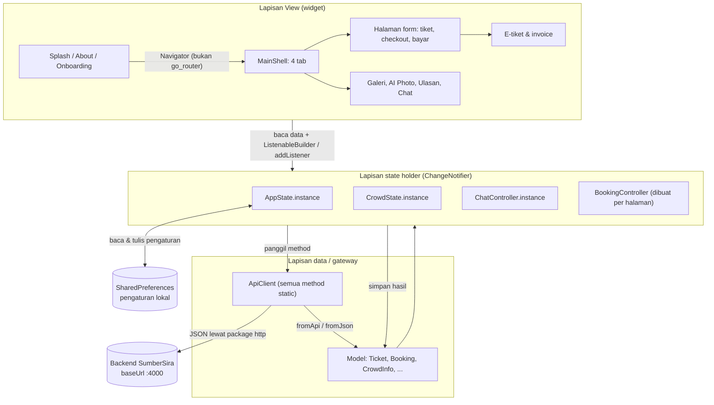
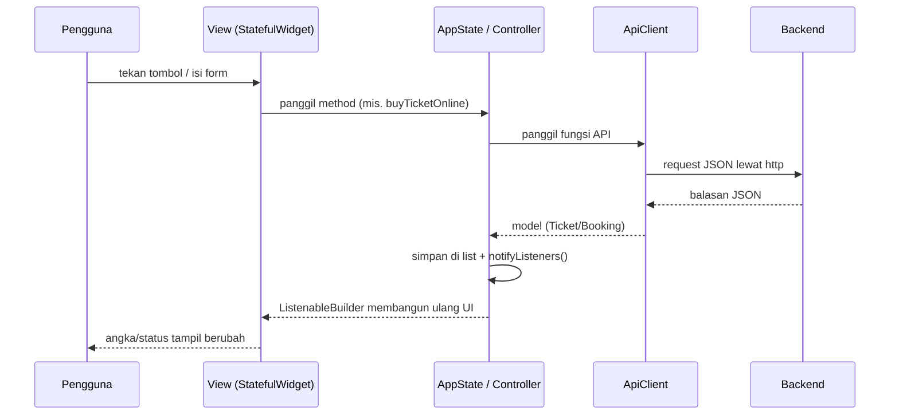
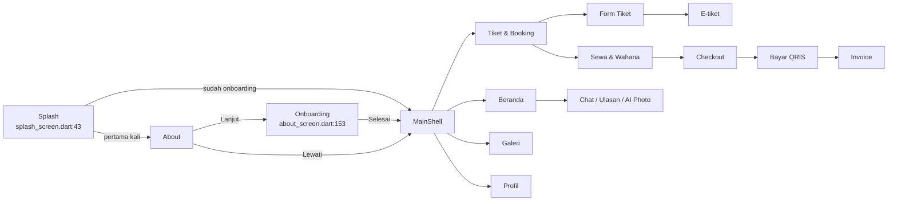
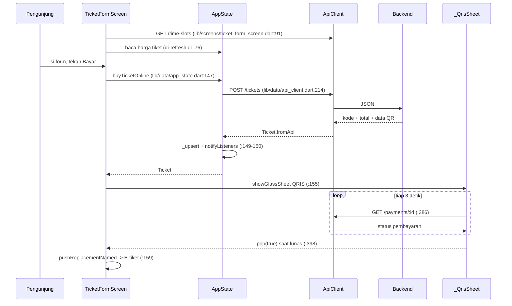
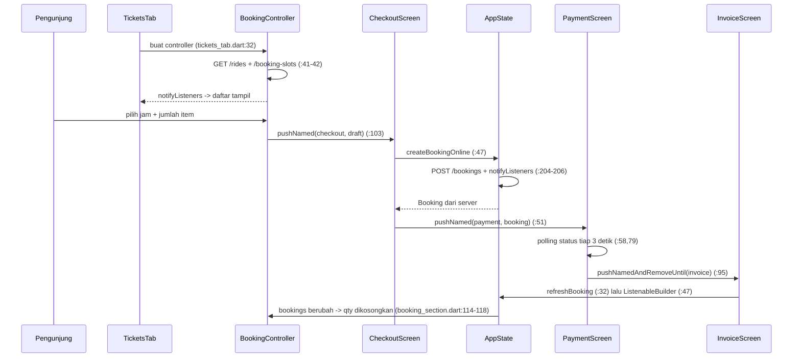
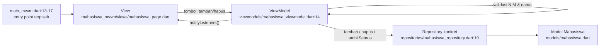
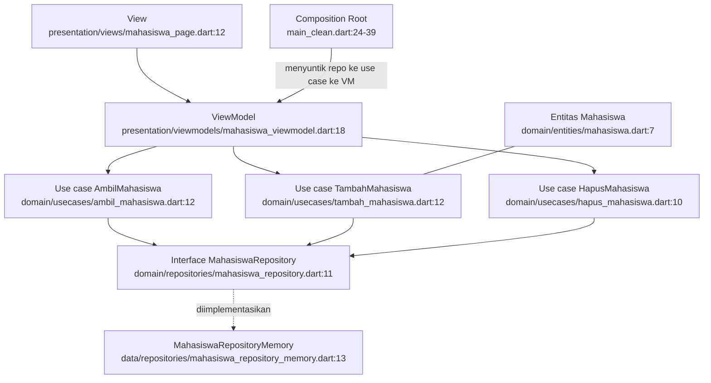

# Panduan Mendalam Struktur Aplikasi Flutter Sumber Sira

> Dokumen ini dibuat untuk mahasiswa pemula yang besok harus presentasi.
> Semua penjelasan diambil dari kode yang benar-benar ada di folder `mobile/lib/`
> dan `mobile/pubspec.yaml`. Tidak ada kode yang diubah saat membuat dokumen ini.
>
> **Aturan membaca:** semua path di bawah relatif terhadap folder `Sumber-Sira/mobile/`,
> misalnya `lib/main.dart:62` berarti file `mobile/lib/main.dart` baris ke-62.
> Nomor baris berasal dari snapshot pukul **14.16 WIB, 18 November 2026**.
> Kalau file diedit lagi setelah itu, nomor baris bisa bergeser.

> **UPDATE REFACTOR (18 November 2026):** struktur `lib/` sudah diubah ke pola
> `lib/features/<fitur>/view` + `viewmodel`. Peta lengkap dan daftar pemindahan ada di
> `docs/STRUKTUR_FEATURES.md`. Path dan nomor baris di dokumen ini merujuk ke snapshot
> **sebelum** refactor, jadi gunakan dokumen tersebut untuk struktur terbaru.

---

## 1. Jawaban singkat untuk presentasi (baca ini dulu)

Kamu menyebut proyek ini memakai **MVVM + Repository, `provider`, `go_router`, dan `http`**.
Dari pembacaan seluruh kode, hanya `http` yang benar-benar sesuai. Berikut koreksinya:

| Klaim awal | Fakta dari kode | Bukti |
|---|---|---|
| State management `provider` | **Tidak dipakai.** Yang dipakai: `ChangeNotifier` dari Flutter + `ListenableBuilder` + `addListener()` manual. Tidak ada `Provider`, `ChangeNotifierProvider`, atau `context.watch` di `lib/`. | `lib/data/app_state.dart:14`, `lib/data/crowd_state.dart:12`, `lib/data/chat_controller.dart:17`, `lib/widgets/booking_section.dart:15`, `lib/screens/eticket_screen.dart:72` |
| Routing `go_router` | **Tidak dipakai.** Yang dipakai: `MaterialApp.routes` + `onGenerateRoute` + `Navigator.pushNamed`, `pushReplacementNamed`, `pushNamedAndRemoveUntil`, `popUntil`. | `lib/main.dart:62-108`, `lib/utils/routes.dart:2-17`, `lib/screens/splash_screen.dart:43` |
| HTTP client `http` | **Benar.** `http: ^1.6.0` ada di dependensi dan dipakai lewat `ApiClient`. | `pubspec.yaml:18`, `lib/data/api_client.dart:4,98-132` |
| MVVM + Repository | **Benar hanya untuk folder praktikum** (`lib/mahasiswa_mvvm/` dan `lib/mahasiswa/`). Aplikasi utama Sumber Sira memakai pola View + state holder + `ApiClient` statis, bukan MVVM formal dengan antarmuka Repository. | `lib/mahasiswa_mvvm/viewmodels/mahasiswa_viewmodel.dart:14`, `lib/mahasiswa/domain/repositories/mahasiswa_repository.dart:11`, `lib/data/api_client.dart:29` |

**Kalimat siap pakai untuk dosen:**
> "Aplikasi utama Sumber Sira bukan memakai paket `provider` atau `go_router`.
> Untuk state, mereka memakai `ChangeNotifier` singleton yang dibaca dengan
> `ListenableBuilder`; untuk navigasi memakai named route bawaan Flutter; dan untuk
> data memakai satu kelas `ApiClient` statis. Pola MVVM dan Clean Architecture
> benar-benar ada, tetapi hanya di dua folder contoh praktikum."

---

## 2. Apa yang saya baca dan batas kejujurannya

- Saya membaca **seluruh file Dart di `lib/`** dan `pubspec.yaml`, bukan hanya sebagian.
- Pada awal pembacaan ada **58 file Dart**. Saat snapshot akhir ada **56 file**, karena dua file
  dihapus di working tree saat pembacaan: `lib/data/dummy_data.dart` dan
  `lib/mahasiswa_mvvm/views/mahasiswa_page.dart` (terlihat dari `git status --short`).
  Keduanya sempat saya baca sebelum dihapus.
- Karena ada file yang dihapus, `lib/main.dart:30` dan `lib/main.dart:99-102` masih
  mengimpor/menuju `mahasiswa_mvvm/views/mahasiswa_page.dart`. **Ini belum terverifikasi**
  sebagai aplikasi yang bisa di-build; perlu `flutter analyze` untuk memastikannya.
  Saya tidak memperbaikinya karena tugas saya hanya menulis dokumentasi.
- Tidak ada klaim di bawah ini yang saya ambil dari luar kode. Jika ragu, saya tandai
  dengan tulisan **belum terverifikasi**.

---

## 3. Peta folder `lib/`

```text
lib/
├── main.dart                     Titik awal aplikasi + daftar rute (110 baris)
├── data/
│   ├── api_client.dart           Satu pintu request ke backend (338)
│   ├── app_state.dart            State utama: tiket, booking, tarif, ulasan, pengaturan (282)
│   ├── chat_controller.dart      State chat "Tanya Sira" (86)
│   ├── crowd_state.dart          State keramaian live (88)
│   └── dummy_data.dart           Dihapus pada snapshot akhir (belum terverifikasi)
├── models/                       Cetakan data + parser JSON
│   ├── ticket.dart  booking.dart  payment.dart  pricing.dart
│   ├── live.dart  gallery.dart  review.dart  wahana.dart
├── screens/                      Halaman & tab
│   ├── splash_screen.dart  about_screen.dart  onboarding_screen.dart
│   ├── main_shell.dart           Kerangka 4 tab
│   ├── home_tab.dart  tickets_tab.dart  gallery_tab.dart  profile_tab.dart
│   ├── ticket_form_screen.dart  eticket_screen.dart
│   ├── checkout_screen.dart  payment_screen.dart  invoice_screen.dart
│   ├── reviews_screen.dart  ai_photo_screen.dart
├── widgets/                      Komponen UI dipakai ulang
│   ├── common.dart  glass.dart  app_background.dart  logo_mark.dart
│   ├── booking_section.dart      Berisi BookingController (state holder)
│   ├── crowd_widgets.dart  floating_chat.dart  photo_form.dart
├── utils/                        Fungsi kecil: routes, format, waktu, validator, upload, launcher
├── theme/app_theme.dart          Warna, tipografi, jarak (palet terkunci)
├── mahasiswa_mvvm/               CONTOH MVVM tradisional (praktikum)
│   ├── main_mvvm.dart
│   ├── models/  repositories/  viewmodels/  views/
└── mahasiswa/                    CONTOH Clean Architecture (praktikum)
    ├── main_clean.dart
    ├── domain/entities  domain/repositories  domain/usecases
    ├── data/repositories
    └── presentation/viewmodels  presentation/views
```

---

## 4. Dependensi: apa yang ada dan apa yang tidak ada

Sumber: `pubspec.yaml:9-25`.

| Package | Versi | Baris | Dipakai untuk |
|---|---|---|---|
| `flutter` | SDK Flutter | 10-11 | Widget, Material, `ChangeNotifier` |
| `cupertino_icons` | ^1.0.9 | 12 | Ikon bergaya iOS |
| `google_fonts` | ^6.2.1 | 13 | Font aplikasi (`lib/theme/app_theme.dart:2`) |
| `intl` | ^0.20.3 | 14 | Rupiah & tanggal Indonesia (`lib/utils/format.dart:1-9`) |
| `qr_flutter` | ^4.1.0 | 15 | QR e-tiket & invoice (`lib/screens/eticket_screen.dart:5`) |
| `shared_preferences` | ^2.5.6 | 16 | Nomor WhatsApp, pengingat, onboarding, URL server (`lib/data/app_state.dart:2,31-37`) |
| `url_launcher` | ^6.3.3 | 17 | Buka Maps/WhatsApp (`lib/utils/launcher.dart:2,11`) |
| `http` | ^1.6.0 | 18 | Semua request API (`lib/data/api_client.dart:4`) |
| `image_picker` | ^1.2.4 | 19 | Pilih foto galeri/kamera |
| `share_plus` | ^13.3.1 | 20 | Bagikan foto |
| `flutter_test`, `flutter_lints` | dev | 22-25 | Tes & aturan gaya kode |

**Tidak ada** `provider` dan **tidak ada** `go_router`, baik di `pubspec.yaml`
maupun di `pubspec.lock` (pencarian menemukan hanya `http`). Pencarian string
`package:provider`, `Provider.`, `ChangeNotifierProvider`, `GoRouter`, dan
`context.go` di `lib/` juga tidak menemukan kecocokan.

---

## 5. Gambaran arsitektur aplikasi utama

Istilah yang perlu diketahui dulu:

- **View** = widget yang terlihat pengguna (halaman, tombol, kartu).
- **State holder** = tempat menyimpan data yang bisa berubah. Di sini memakai
  **`ChangeNotifier`**, kelas bawaan Flutter yang bisa memberi tahu widget:
  "data berubah, gambar ulang ya!" lewat `notifyListeners()`.
- **Singleton** = hanya ada satu objek untuk seluruh aplikasi. Di sini ditulis
  `static final ... instance = ...` (misal `AppState.instance`).
- **`ListenableBuilder`** = widget yang mendengarkan `ChangeNotifier` dan
  membangun ulang tampilan saat `notifyListeners()` dipanggil.
- **Repository** = tempat pengambilan data. Di aplikasi utama, perannya dijalankan
  oleh `ApiClient` (kelas statis), bukan oleh kelas bernama `Repository`.



**Poin penting:** View hampir tidak pernah memanggil `http` langsung. Pengecualian
ada di `lib/screens/ai_photo_screen.dart:5,117` yang memakai `http.get` untuk
mengunduh file hasil dari URL yang diberikan server. Jadi `ApiClient` adalah
"pintu utama" API, bukan satu-satunya pemanggil `http` secara harfiah.

---

## 6. State management: `ChangeNotifier`, bukan `provider`

### 6.1 Empat state holder utama

| Nama | File | Jenis | Isi yang dijaga |
|---|---|---|---|
| `AppState` | `lib/data/app_state.dart:14-16` | singleton | `tickets`, `bookings`, `reviews`, tarif, nomor WhatsApp, pengingat, onboarding, URL server |
| `CrowdState` | `lib/data/crowd_state.dart:12-19` | singleton | info keramaian, penanda stale, timer 30 detik, jumlah pemakai |
| `ChatController` | `lib/data/chat_controller.dart:17-29` | singleton | daftar pesan, `busy`, `online`, pertanyaan cepat |
| `BookingController` | `lib/widgets/booking_section.dart:15-32` | objek biasa, dibuat di `lib/screens/tickets_tab.dart:32` | daftar wahana, jam, jumlah tiap item, `loading`, `error` |

Contoh singleton (4 baris saja):

```dart
// lib/data/app_state.dart:14-16
class AppState extends ChangeNotifier {
  AppState._();
  static final AppState instance = AppState._();
}
```

### 6.2 Alur perubahan state



Potongan `ListenableBuilder` (pola yang dipakai berulang):

```dart
// lib/screens/eticket_screen.dart:72-75
child: ListenableBuilder(
  listenable: AppState.instance,
  builder: (context, _) {
    final t = AppState.instance.find(code);
```

Ada juga listener manual ketika widget perlu melakukan aksi khusus, misalnya
form tiket mengikuti perubahan tarif (`lib/screens/ticket_form_screen.dart:75,79-81,115`)
dan controller booking mengikuti perubahan jumlah booking
(`lib/widgets/booking_section.dart:19,108-119,123`). Polanya selalu pasangan
`addListener()` di `initState` dan `removeListener()` di `dispose`
(contoh `lib/widgets/floating_chat.dart:121,127`).

### 6.3 Kenapa ini mirip MVVM, tapi bukan paket `provider`

Secara konsep, `AppState`/`BookingController` berperan seperti **ViewModel**:
menyimpan state, menjalankan aksi, lalu memberi tahu View. Bedanya:
tidak ada `ChangeNotifierProvider` di atas widget, tidak ada `context.watch`,
dan objeknya diakses langsung lewat `.instance`. Itulah sebabnya dokumentasi ini
menyebutnya **state holder**, bukan "ViewModel resmi".

---

## 7. `ApiClient`: "repository" versi aplikasi utama

`ApiClient` didefinisikan di `lib/data/api_client.dart:29` dan **seluruh methodnya
statis** (tidak perlu dibuat objek). Komentar di baris 28 menyebutnya
"Pintu tunggal ke backend SumberSira".

### 7.1 Alamat backend

`baseUrl` dihitung otomatis di `lib/data/api_client.dart:39-58`:

- `customBaseUrl` (diatur pengguna lewat Profil) paling diprioritaskan → baris 40;
- lalu `--dart-define=API_URL=...` → baris 41-42;
- Web: host halaman dipakai ulang dengan port 4000 bila dibuka lewat IP LAN → baris 43-51;
- Desktop: `http://localhost:4000` → baris 52-56;
- Android (emulator): `http://10.0.2.2:4000` → baris 57.

Pengaturan URL disimpan dengan `shared_preferences` di
`lib/data/app_state.dart:51-64`, dan tombol "Tes Koneksi" memanggil
`GET /health` lewat `checkHealth()` (`lib/data/api_client.dart:60-70`,
dipanggil di `lib/screens/profile_tab.dart:78`).

### 7.2 Satu fungsi untuk semua request JSON

```dart
// lib/data/api_client.dart:98-115 (dipotong)
static Future<dynamic> _request(String method, String path, {Object? body}) async {
  final uri = Uri.parse('$baseUrl$path');
  final http.Response res;
  try {
    final encoded = body == null ? null : jsonEncode(body);
    final headers = encoded == null ? null : {'content-type': 'application/json'};
    res = await switch (method) {
      'POST' => http.post(uri, headers: headers, body: encoded),
      'PATCH' => http.patch(uri, headers: headers, body: encoded),
      'PUT' => http.put(uri, headers: headers, body: encoded),
      _ => http.get(uri),
    }.timeout(_timeout);
  } catch (_) {
    throw ApiException('Tidak dapat terhubung ke server.', code: 'OFFLINE');
  }
```

Fungsi ini juga mengubah status error jadi pesan Bahasa Indonesia
(`_message`, baris 75-95), menolak balasan kosong (baris 126-130), dan
membantu pengecekan bentuk JSON lewat `_getList`/`_getMap` (baris 167-183).
Unggah foto memakai jalur terpisah `postMultipart` (baris 134-163) dengan timeout 45 detik.

### 7.3 Daftar endpoint yang dipakai

| Endpoint | Fungsi di `ApiClient` | Baris | Dipanggil dari |
|---|---|---|---|
| `GET /health` | `checkHealth` | 60-70 | `screens/profile_tab.dart:78` |
| `GET /rides` | `fetchWahana` | 186-189 | `widgets/booking_section.dart:41` |
| `GET /time-slots` | `fetchTimeSlots` | 192-195 | `screens/ticket_form_screen.dart:91` |
| `GET /crowd` | `fetchCrowd` | 200 | `data/crowd_state.dart:47` |
| `POST /tickets` | `buyTicket` | 205-224 | `data/app_state.dart:148` |
| `GET /tickets`, `/tickets/:code` | `fetchTickets`, `fetchTicket` | 227-234 | `data/app_state.dart:165,187` |
| `GET /pricing` | `fetchPricing` | 239 | `data/app_state.dart:89` |
| `GET /payments/:id`, `POST .../simulate-pay` | `fetchPayment`, `simulatePayment` | 242-246 | `ticket_form_screen.dart:386,406`, `payment_screen.dart:79,103` |
| `GET /booking-slots` | `fetchBookingSlots` | 251-254 | `widgets/booking_section.dart:42` |
| `POST /bookings` | `createBooking` | 258-266 | `data/app_state.dart:204` |
| `GET /bookings`, `/bookings/:code` | `fetchBookings`, `fetchBooking` | 269-276 | `data/app_state.dart:166,224` |
| `GET /reviews`, `POST /reviews` | `fetchReviews`, `postReview` | 281-285 | `data/app_state.dart:262,279` |
| `GET /gallery`, `POST /gallery` | `fetchGallery`, `uploadGalleryPhoto` | 290-308 | `screens/gallery_tab.dart:45` |
| `POST /ai-photo`, `.../share-to-gallery` | `enhancePhoto`, `shareAiPhotoToGallery` | 311-322 | `screens/ai_photo_screen.dart:91,150` |
| `GET /chat/quick-questions`, `POST /chat` | `fetchQuickQuestions`, `askChat` | 327-337 | `data/chat_controller.dart:34,65` |

Semua angka harga, kode, total, status, dan QR **berasal dari server**; aplikasi
sengaja tidak menyimpan harga cadangan (lihat `lib/data/app_state.dart:67-68`,
`lib/models/pricing.dart:27-28`, dan `lib/widgets/booking_section.dart:24,35`).

---

## 8. Model data: hasil JSON menjadi objek Dart

| Model | File | Cara dibuat dari server |
|---|---|---|
| `Ticket` | `lib/models/ticket.dart:39-91` | `Ticket.fromApi()` di baris 66; enum status di baris 4-35 |
| `Booking`, `BookingDraft`, `BookingLine` | `lib/models/booking.dart:6-80` | `Booking.fromApi()` di baris 60; `rideId` dipakai saat kirim booking |
| `PricingData`, `ParkingTarif` | `lib/models/pricing.dart:4-48` | `fromJson` tanpa nilai cadangan |
| `CrowdInfo` | `lib/models/live.dart:5-25` | `fromJson`, termasuk ramalan per jam |
| `GalleryPhoto`, `AiPhotoResult` | `lib/models/gallery.dart` | `fromApi` |
| `Review`, `ReviewSummary` | `lib/models/review.dart` | `fromApi` |
| `PaymentInfo` | `lib/models/payment.dart` | `fromJson` |
| `Wahana` | `lib/models/wahana.dart` | `fromJson` |

Waktu dari server dikirim dalam UTC, lalu diubah ke **WIB (UTC+7)** supaya tidak
bergantung zona waktu HP. Lihat `lib/utils/waktu.dart:3-24`,
`lib/models/ticket.dart:93-97`, dan `lib/utils/format.dart:3-9`.
`initializeDateFormatting('id_ID')` dipanggil di `lib/main.dart:40`.

Contoh potongan model:

```dart
// lib/models/booking.dart:27-34
class BookingDraft {
  const BookingDraft({required this.slot, required this.lines});
  final String slot;
  final List<BookingLine> lines;
  int get total => lines.fold(0, (sum, l) => sum + l.subtotal);
}
```

---

## 9. Navigasi: `Navigator`, bukan `go_router`

### 9.1 Daftar rute

Didefinisikan di `lib/utils/routes.dart:2-17` dan dipasang di
`lib/main.dart:67-107`.

| Nama rute | Path | Halaman | Cara dibuka |
|---|---|---|---|
| `AppRoutes.splash` | `/` | `SplashScreen` | `initialRoute` (`main.dart:67`) |
| `AppRoutes.about` | `/tentang` | `AboutScreen` | `pushReplacementNamed` dari Splash (`splash_screen.dart:43`) |
| `AppRoutes.onboarding` | `/onboarding` | `OnboardingScreen` | `pushReplacementNamed` (`about_screen.dart:153`) |
| `AppRoutes.main` | `/main` | `MainShell` | `pushNamedAndRemoveUntil` (`about_screen.dart:22`, `onboarding_screen.dart:92`) |
| `AppRoutes.buyTicket` | `/tiket/beli` | `TicketFormScreen` | `pushNamed` (`tickets_tab.dart:131`) |
| `AppRoutes.eticket` | `/tiket/detail` | `ETicketScreen(code)` | `pushReplacementNamed` + argumen (`ticket_form_screen.dart:159`) atau `push` + constructor (`tickets_tab.dart:237`) |
| `AppRoutes.checkout` | `/booking/checkout` | `CheckoutScreen(draft)` | `pushNamed` + argumen (`booking_section.dart:103`) |
| `AppRoutes.payment` | `/booking/bayar` | `PaymentScreen(booking)` | `pushNamed` + argumen (`checkout_screen.dart:51`) |
| `AppRoutes.invoice` | `/booking/invoice` | `InvoiceScreen(code)` | `pushNamedAndRemoveUntil` (`payment_screen.dart:95`) atau dari riwayat (`tickets_tab.dart:251`) |
| `AppRoutes.aiPhoto` | `/ai-photo` | `AiPhotoScreen` | `pushNamed` (`home_tab.dart:107,117`) |
| `AppRoutes.reviews` | `/ulasan` | `ReviewsScreen` | `pushNamed` (`home_tab.dart:108,117`) |
| `AppRoutes.praktikumClean` | `/praktikum/clean` | `MahasiswaPage(vm)` | `onGenerateRoute` (`main.dart:87-98`) |
| `AppRoutes.praktikumMvvm` | `/praktikum/mvvm` | `mvvm.MahasiswaPage` | `onGenerateRoute` (`main.dart:99-102`) |

Rute dengan argumen tidak bisa dimasukkan ke peta `routes` biasa, karena itu
`onGenerateRoute` memeriksa tipe `arguments` dengan `switch`
(`lib/main.dart:79-105`). Rute tidak dikenal jatuh ke `MainShell`
(`lib/main.dart:107`).

### 9.2 Diagram perpindahan halaman



Tombol "kembali ke Beranda" memakai `Navigator.popUntil(context,
ModalRoute.withName(AppRoutes.main))` di `lib/screens/eticket_screen.dart:157`
dan `lib/screens/invoice_screen.dart:119`.

---

## 10. Alur fitur utama (ini yang biasanya ditanya dosen)

### 10.1 Beli tiket + QRIS



Catatan: kalau pembayaran memilih **tunai**, sheet QRIS dilewati dan layar
langsung ke e-tiket dengan status menunggu di loket
(`lib/screens/ticket_form_screen.dart:153-159`). E-tiket melakukan
`GET /tickets/:code` tiap 5 detik agar status berubah saat petugas memindai QR
(`lib/screens/eticket_screen.dart:35-46`).

### 10.2 Sewa & booking + pembayaran



Jika server mengembalikan `RIDE_UNAVAILABLE`, Checkout menandai daftar wahana
basi lewat `AppState.tandaiWahanaStale()` (`lib/screens/checkout_screen.dart:55-60`,
`lib/data/app_state.dart:235-239`), lalu `BookingController` memuat ulang daftar
(`lib/widgets/booking_section.dart:108-113`).

### 10.3 Riwayat tanpa login

Aplikasi ini **tidak punya login**. Riwayat dicari berdasarkan nomor WhatsApp:

- `lib/screens/tickets_tab.dart:55-67` memanggil `AppState.syncHistory(wa)`;
- `lib/data/app_state.dart:162-174` mengambil `GET /tickets` dan `GET /bookings`,
  lalu menggabungkannya ke list di memori;
- nomor terakhir disimpan di perangkat agar terisi otomatis
  (`lib/data/app_state.dart:121-126`, `lib/screens/tickets_tab.dart:47-49`).

### 10.4 Fitur lain (ringkas)

| Fitur | State/controller | File penting |
|---|---|---|
| Live Crowd (polling 30 detik) | `CrowdState` | `data/crowd_state.dart:45-78`, dipakai `screens/main_shell.dart:31,37`, ditampilkan `widgets/crowd_widgets.dart:47-73` |
| Chat "Tanya Sira" | `ChatController` | `data/chat_controller.dart:32-85`, UI `widgets/floating_chat.dart:117-179`, dipasang di `screens/home_tab.dart:39` |
| Ulasan & rating | `AppState` | `screens/reviews_screen.dart:26-57`, `data/app_state.dart:255-281` |
| Galeri foto | state lokal `StatefulWidget` | `screens/gallery_tab.dart:38-90`, validasi `utils/photo_upload.dart:10-16` |
| AI Photo Studio | state lokal `StatefulWidget` | `screens/ai_photo_screen.dart:82-105,117,150` |

---

## 11. Contoh MVVM tradisional: folder `mahasiswa_mvvm/`

Ini bagian yang paling cocok untuk menjelaskan MVVM "versi buku teks" kepada kelas.



Alur datanya:

- **Model**: `lib/mahasiswa_mvvm/models/mahasiswa.dart` (cetakan data sederhana).
- **Repository**: `lib/mahasiswa_mvvm/repositories/mahasiswa_repository.dart:10-31`,
  menyimpan data di **memori** (`List<Mahasiswa>`), bukan HTTP.
- **ViewModel**: `lib/mahasiswa_mvvm/viewmodels/mahasiswa_viewmodel.dart:14-57`,
  mewarisi `ChangeNotifier`, menyimpan `pesanError`, menjalankan validasi.
- **View**: memakai `ListenableBuilder`; pada pembacaan awal ada di
  `lib/mahasiswa_mvvm/views/mahasiswa_page.dart:83`.

Potongan ViewModel (12 baris):

```dart
// lib/mahasiswa_mvvm/viewmodels/mahasiswa_viewmodel.dart:28-47 (dipotong)
void tambah(String nim, String nama) {
  nim = nim.trim();
  nama = nama.trim();
  if (nim.isEmpty || nama.isEmpty) {
    pesanError = 'NIM dan nama wajib diisi';
  } else if (repository.nimSudahAda(nim)) {
    pesanError = 'NIM sudah digunakan';
  } else {
    repository.tambah(Mahasiswa(nim: nim, nama: nama));
    pesanError = null;
  }
  notifyListeners();
}
```

Entry point terpisah ada di `lib/mahasiswa_mvvm/main_mvvm.dart:13-17`
(cara menjalankan: `flutter run -t lib/mahasiswa_mvvm/main_mvvm.dart`, baris 4).

**Catatan snapshot:** file `views/mahasiswa_page.dart` sudah terhapus di working
tree saat akhir pembacaan, sehingga rute `/praktikum/mvvm` di `lib/main.dart:99-102`
**belum terverifikasi** bisa dijalankan. Isi View-nya saya sebutkan hanya berdasarkan
pembacaan sebelum penghapusan.

---

## 12. Contoh Clean Architecture: folder `mahasiswa/`

Clean Architecture = lapisan dibagi lebih tebal: **domain** (aturan bisnis) →
**data** (sumber data) → **presentation** (UI). Aturan pentingnya: domain tidak
boleh tahu detail Flutter atau HTTP.



Penjelasan singkat:

- **Entity**: `lib/mahasiswa/domain/entities/mahasiswa.dart:7-19`, data murni
  tanpa dependensi Flutter.
- **Interface repository**: `lib/mahasiswa/domain/repositories/mahasiswa_repository.dart:11-23`,
  berisi kontrak `ambilSemua`, `nimSudahAda`, `tambah`, `hapus`.
- **Implementasi**: `lib/mahasiswa/data/repositories/mahasiswa_repository_memory.dart:13-44`,
  memakai list in-memory dengan dua data awal (Andi & Budi).
- **Use case**: aturan bisnis ada di sini, bukan di ViewModel. Contoh validasi
  NIM kosong dan duplikat melempar `ArgumentError`/`StateError`
  (`lib/mahasiswa/domain/usecases/tambah_mahasiswa.dart:20-40`).
- **ViewModel**: menangkap error itu menjadi `pesanError` lalu `notifyListeners()`
  (`lib/mahasiswa/presentation/viewmodels/mahasiswa_viewmodel.dart:18-65`).
- **Composition root**: `lib/mahasiswa/main_clean.dart:24-39` merakit objek dari
  bawah ke atas. Pola yang sama juga dipakai di `lib/main.dart:87-98` untuk rute
  `/praktikum/clean`.

Potongan use case (11 baris):

```dart
// lib/mahasiswa/domain/usecases/tambah_mahasiswa.dart:20-40 (dipotong)
void execute(String nim, String nama) {
  nim = nim.trim();
  nama = nama.trim();
  if (nim.isEmpty || nama.isEmpty) {
    throw ArgumentError('NIM dan nama wajib diisi');
  }
  if (repository.nimSudahAda(nim)) {
    throw StateError('NIM sudah digunakan');
  }
  repository.tambah(Mahasiswa(nim: nim, nama: nama));
}
```

Potongan composition root (9 baris):

```dart
// lib/main.dart:90-96
final repo = MahasiswaRepositoryMemory();
final vm = MahasiswaViewModel(
  ambilMahasiswa: AmbilMahasiswa(repo),
  tambahMahasiswa: TambahMahasiswa(repo),
  hapusMahasiswa: HapusMahasiswa(repo),
);
return MahasiswaPage(vm: vm);
```

---

## 13. Ringkasan peran file penting

| File | Peran satu kalimat |
|---|---|
| `lib/main.dart:35-54` | `main()` async: siapkan `intl`, baca pengaturan, `runApp`, lalu muat harga & chat setelah UI tampil |
| `lib/main.dart:62-108` | `MaterialApp`: tema, rute, rute berargumen, fallback |
| `lib/data/app_state.dart` | Pusat state aplikasi + aksi tiket/booking/ulasan + pengaturan lokal |
| `lib/data/api_client.dart` | Semua endpoint backend, timeout, pesan error, multipart |
| `lib/data/crowd_state.dart` | Pengambil keramaian berkala dengan hitungan pemakai |
| `lib/data/chat_controller.dart` | Riwayat chat & status koneksi bot |
| `lib/widgets/booking_section.dart` | `BookingController` + daftar wahana + bar total |
| `lib/screens/ticket_form_screen.dart` | Form tiket, validasi, QRIS sheet, polling pembayaran |
| `lib/screens/tickets_tab.dart` | Tiga segmen: tiket, sewa/wahana, riwayat per WhatsApp |
| `lib/screens/checkout_screen.dart` | Ringkasan booking + pembuatan booking di server |
| `lib/screens/payment_screen.dart` | QRIS booking + hitung mundur + polling status |
| `lib/screens/invoice_screen.dart` | Faktur yang dibaca ulang dari server |
| `lib/screens/eticket_screen.dart` | E-tiket + polling status check-in |
| `lib/screens/main_shell.dart` | Kerangka 4 tab + hidupkan/matikan live crowd |
| `lib/theme/app_theme.dart:4-17` | Palet warna tetap (Hijau Tua, Hijau Daun, Ink, Abu, Coral) |
| `lib/widgets/glass.dart:7-15` | Efek "kaca" hanya untuk lapisan navigasi/CTA |
| `lib/utils/format.dart` | Rupiah, tanggal Indonesia, normalisasi nomor WhatsApp, label jam |
| `lib/utils/launcher.dart:6-23` | Buka tautan eksternal & pesan `wa.me` |

---

## 14. Hal yang masih perlu diverifikasi

1. **Build/analyzer belum dijalankan.** Karena `lib/mahasiswa_mvvm/views/mahasiswa_page.dart`
   terhapus pada snapshot akhir tetapi masih diimpor di `lib/main.dart:30,99-102`
   dan `lib/mahasiswa_mvvm/main_mvvm.dart:10`, status kompilasi **belum terverifikasi**.
2. **`lib/data/dummy_data.dart` dan `assets/data/wahana.json` terhapus** pada snapshot
   akhir. Kode yang tersisa memang tidak lagi memakai data cadangan
   (lihat `lib/widgets/booking_section.dart:24,35` dan `lib/data/crowd_state.dart:10-11`),
   tetapi saya tidak mengecek referensi lama secara menyeluruh setelah penghapusan.
   Klaim di dokumen ini tidak bergantung pada kedua file tersebut.
3. **Nomor baris** berlaku untuk snapshot 14.16 WIB. Bila kamu membuka file lebih
   lalu dan barisnya bergeser, percayalah pada kode yang terlihat, bukan angka di sini.
4. **Backend tidak saya jalankan.** Semua endpoint dalam tabel diambil dari
   definisi di `lib/data/api_client.dart`, bukan dari hasil testing langsung.

---

## 15. Cara menjelaskan dalam 3 menit di depan kelas

1. Tunjukkan `pubspec.yaml:18` — hanya `http`, tidak ada `provider`/`go_router`.
2. Tunjukkan `lib/main.dart:62-108` — navigasi memakai named route Flutter.
3. Tunjukkan `lib/data/app_state.dart:14-16` + `lib/screens/eticket_screen.dart:72-75`
   — state memakai `ChangeNotifier` singleton yang didengar `ListenableBuilder`.
4. Tunjukkan `lib/data/api_client.dart:98` — satu pintu request ke backend.
5. Terakhir tunjukkan dua folder praktikum: `mahasiswa_mvvm/` (MVVM sederhana)
   dan `mahasiswa/` (Clean Architecture dengan use case).

Itu saja. Kalau dosen bertanya "kenapa tidak pakai provider?", jawab jujur:
"Karena implementasinya memakai `ChangeNotifier` langsung; secara konsep mirip,
tapi tidak ada package `provider` di proyek ini."

---

*Dibuat hanya dengan membaca kode. Tidak ada file kode yang diubah.*
